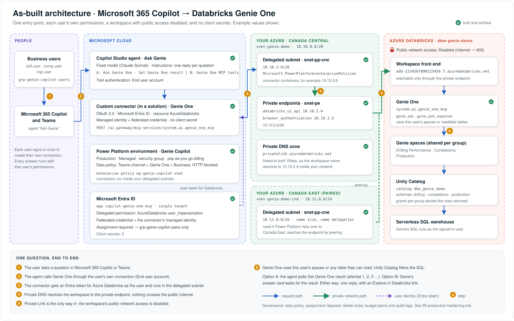
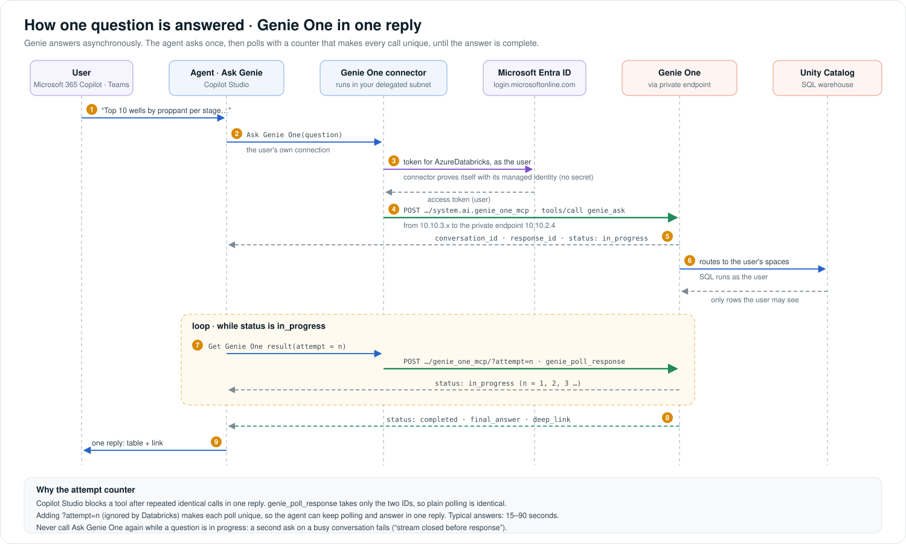
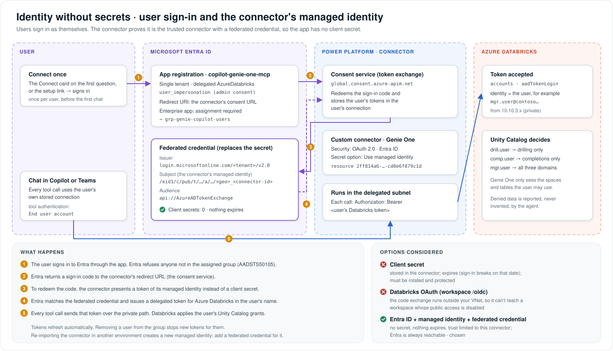
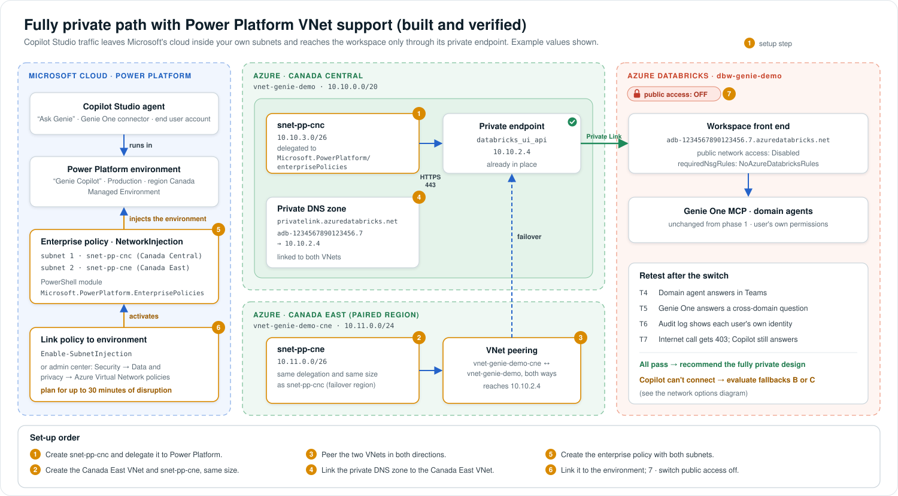
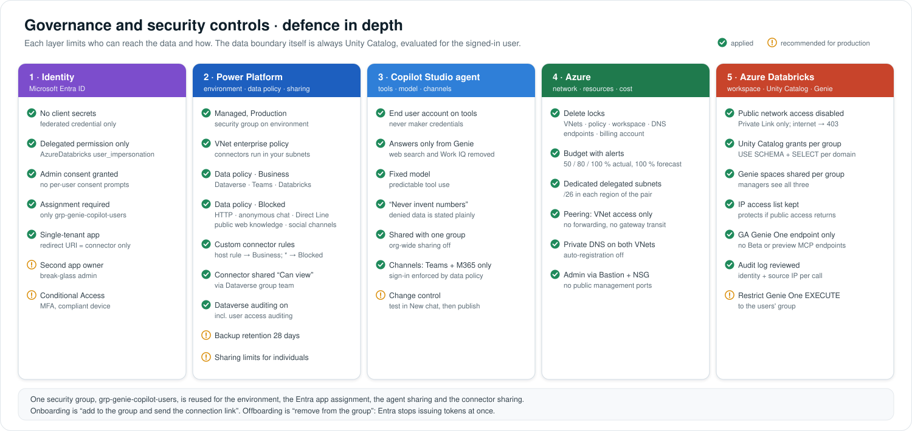
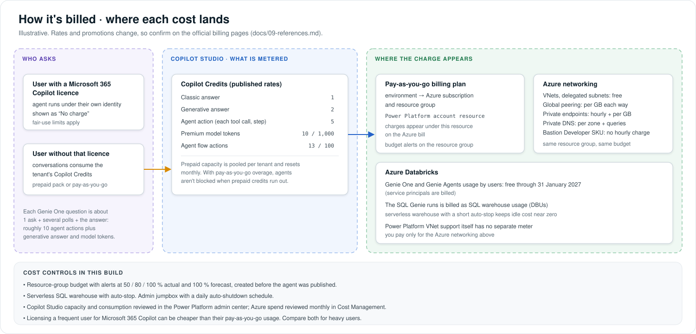
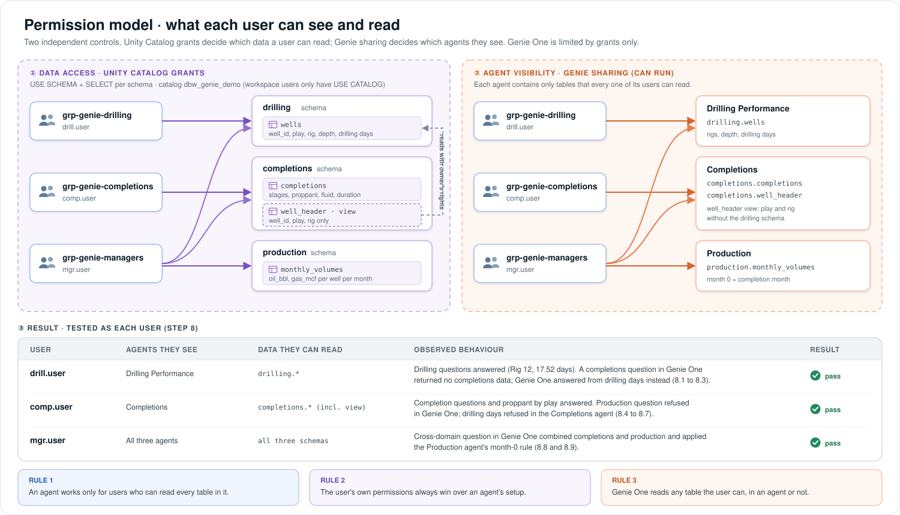
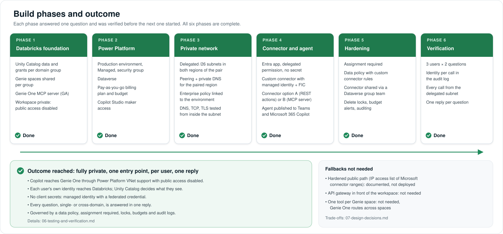

# Connect Microsoft 365 Copilot to Databricks Genie on a private workspace

A tested, end-to-end reference for answering business questions from **Databricks Genie** inside **Microsoft 365
Copilot and Teams**, with four properties:

- **One entry point.** Users ask in plain English. **Genie One** routes each question to the right domain Genie
  space and answers cross-domain questions in one go. It isn't limited to Genie spaces: it can also query any table
  the user can read directly ([read this before you choose](#what-genie-one-can-reach)).
- **Each user's own permissions.** Every query runs as the signed-in user, so Unity Catalog grants decide what each
  person sees. There is no shared service account.
- **Fully private.** The Databricks workspace has **public network access disabled**. Copilot's calls run inside your
  own subnets through **Power Platform VNet support** and reach the workspace only through its private endpoint.
- **No secrets.** The connector signs users in through Microsoft Entra ID with a **managed identity and federated
  credential**, so there is no client secret to store, rotate or let expire.

**Who it's for:** architects, platform engineers and administrators in any organisation that wants Microsoft 365
Copilot to answer from governed Databricks data without exposing the workspace. The example data is fictional; the
pattern is industry-neutral. Start with the [adoption guide](docs/00-adoption-guide.md) to map it to your
organisation.

All names, URLs and IP ranges in this repository are **example values**. Replace them with your own.

> **Status: built, hardened and verified end to end.**
> Three test users with different permissions asked the same questions in Microsoft 365 Copilot and Teams. Each got
> exactly the data their Unity Catalog grants allow, in a single reply, with every call arriving from the private
> subnet. See [docs/06-testing-and-verification.md](docs/06-testing-and-verification.md).



---

## What Genie One can reach

Genie has no data access of its own. Every query runs as the signed-in user, so **Unity Catalog grants are the only
real security boundary**. A Genie space (agent) can only **narrow** what a user reaches. It never widens it. **Genie
One isn't limited by Genie spaces at all**: if the user can read a table, Genie One can answer from it, whether or not
the table is in any space.

| User can read the table? | Table in a space the user can use? | Asked through | Result |
|---|---|---|---|
| ✅ Yes | ✅ Yes | The space | Answers |
| ✅ Yes | ✅ Yes | Genie One | Answers, through the space and its business rules |
| ✅ Yes | ❌ No | The space | Refuses: the data isn't in this space |
| ✅ Yes | ❌ No | Genie One | ⚠️ **Answers by querying the table directly**, without curation |
| ❌ No | ✅ Yes (shared with the user) | The space | Space disabled for that user (*no SELECT access* banner) |
| ❌ No | ✅ Yes | Genie One | No data returned |

So connecting Copilot to Genie One (this build) exposes **everything each user can read in the workspace**.
Connecting Copilot to individual Genie spaces limits it to curated data. Genie One's workspace instructions (for
example *"answer only through agents"*) **don't enforce this**: in testing, the same question was answered from the
table on one run and refused on the next. No admin setting limits Genie One to spaces.

The reference build uses Genie One safely because **every business table each test user can read is part of a curated space**
(their grants are one schema per domain, and each schema's tables are all in that domain's space).
If your grants are broader than that, prefer one tool per Genie space. See
[07-design-decisions.md, D2](docs/07-design-decisions.md#d2-entry-point-genie-one-vs-one-tool-per-genie-space).

---

## Start here

| Step | Guide | What you get |
|---|---|---|
| 0 | [docs/00-adoption-guide.md](docs/00-adoption-guide.md) | Fit check, mapping to your domains, decisions, region pairs, planning worksheet, roadmap |
| 1 | [docs/01-databricks-build-guide.md](docs/01-databricks-build-guide.md) | Unity Catalog data and grants, domain Genie spaces, Genie One, private workspace |
| 2 | [docs/02-prerequisites-licensing-and-billing.md](docs/02-prerequisites-licensing-and-billing.md) | Prerequisites, licences, admin roles per step, how billing works |
| 3 | [docs/03-private-connectivity-power-platform-vnet.md](docs/03-private-connectivity-power-platform-vnet.md) | Delegated subnets, peering, DNS, enterprise policy, verification from inside the subnet |
| 4 | [docs/04-genie-one-connector-and-copilot-agent.md](docs/04-genie-one-connector-and-copilot-agent.md) | Entra app, solution, the two custom connector options, sharing, Copilot Studio agent, publishing, user onboarding |
| 5 | [docs/05-production-hardening.md](docs/05-production-hardening.md) | Identity, data policy, sharing, auditing, locks, budgets, Databricks least privilege |
| 6 | [docs/06-testing-and-verification.md](docs/06-testing-and-verification.md) | Test matrix, audit-log queries, results |
| 7 | [docs/07-design-decisions.md](docs/07-design-decisions.md) | The options considered at each decision and why each choice was made |
| 8 | [docs/08-troubleshooting.md](docs/08-troubleshooting.md) | Symptom → cause → fix for every issue you're likely to meet |
| 9 | [docs/09-references.md](docs/09-references.md) | Official Microsoft and Azure Databricks documentation |
| 10 | [docs/10-preview-features-and-production-readiness.md](docs/10-preview-features-and-production-readiness.md) | Which features are Preview, Beta or GA, what to do about each, go-live checklist |

The complete guide is also available as one document:

- **PDF** for reading on any device, including mobile, with bookmarks and a linked contents page: [docs/Copilot-Genie-One-Private-Integration-Guide.pdf](docs/Copilot-Genie-One-Private-Integration-Guide.pdf)
- **Word** for editing or adapting: [docs/Copilot-Genie-One-Private-Integration-Guide.docx](docs/Copilot-Genie-One-Private-Integration-Guide.docx)

## Preview features to know about before production

| Feature | Status | How this design handles it |
|---|---|---|
| Databricks **Managed MCP Servers** (workspace preview toggle) | Public Preview | **Not required, and turned off.** The agent calls only the **GA** Genie One MCP server, verified end to end with the toggle off |
| Databricks **audit log system table** | Public Preview | Used for evidence; add diagnostic log delivery for compliance retention |
| Copilot Studio **MCP tools** in the Microsoft Copilot agent experience | Preview | Connector **option A** uses GA connector actions (no dependency); **option B** uses MCP tools (accepted preview exception) |
| Copilot Studio **MCP apps** (Genie's interactive answer card, option B) | No preview label; Microsoft 365 Copilot only, not Teams | Teams receives the answer as text |
| Workspace-level Genie MCP **Beta** endpoint (`/api/2.0/mcp/genie`) | End of life 30 Nov 2026 | Not used |
| Claude models in Copilot Studio | GA, needs admin opt-in; processed outside the EU Data Boundary | Data-protection sign-off, or choose a GA OpenAI model |

Details and the go-live checklist: [docs/10-preview-features-and-production-readiness.md](docs/10-preview-features-and-production-readiness.md).

## Scenarios

| Scenario | Who | How it works | Status |
|---|---|---|---|
| **1. Domain question** | A specialist, for example a drilling engineer | Genie One answers from the one Genie space the user can access | ✅ Verified |
| **2. Cross-domain question** | Managers and analysts | Genie One combines the Completions and Production spaces in one answer | ✅ Verified |
| **3. Fully private** | Organisations that can't expose the workspace | Power Platform VNet support → private endpoint; public access disabled | ✅ Verified |
| **4. Hardened public path** | Only if a private path isn't possible | Public access limited by an IP access list | Documented as a fallback, not deployed |

## Verified results

| Question | drill.user (drilling) | comp.user (completions) | mgr.user (managers) |
|---|---|---|---|
| *Which rig has the lowest average drilling days?* | ✅ Rig 12, 17.52 days | ❌ No access to drilling data | ✅ Rig 12, 17.52 days |
| *Top 10 wells by proppant per stage and their first-3-month oil* | ❌ No completions or production data | ⚠️ Proppant ranking only; oil not available | ✅ Full table, 39,653 bbl total |

Every answer arrived in **one reply**. The Databricks audit log showed each user's own identity, and every call came
from the delegated subnet while public access was off.

## The solution at a glance

| Layer | Component | Key setting |
|---|---|---|
| Users | Microsoft 365 Copilot, Teams | Agent *Ask Genie*, shared with one security group |
| Copilot Studio | Agent *Ask Genie* | Fixed model; Genie One tools with **End user account** authentication, shared with the users' group. Genie One reaches every table the user can read ([see above](#what-genie-one-can-reach)) |
| Power Platform | Environment *Genie Copilot* | Production, **Managed**, security group, pay-as-you-go billing, data policy, VNet enterprise policy |
| Connector | Custom connector in a solution: **option A** *Genie One* (two REST actions) or **option B** *Genie One MCP* (MCP server) | OAuth 2.0 with Microsoft Entra ID, **managed identity**, resource AzureDatabricks |
| Identity | Entra app `copilot-genie-one-mcp` | Delegated `user_impersonation`, **federated credential only**, assignment required |
| Network | Delegated subnets in the region pair, peering, private DNS | `10.10.3.0/26` + `10.11.0.0/26` → private endpoint `10.10.2.4` |
| Databricks | Workspace with **public access disabled** | Genie One (`system.ai.genie_one_mcp`), domain Genie spaces, Unity Catalog grants per group |

## Diagrams

| | |
|---|---|
| [](docs/images/01-target-architecture.svg) **As-built architecture** | [](docs/images/09-request-sequence.svg) **How one question is answered** |
| [](docs/images/10-identity-secretless-auth.svg) **Identity without secrets** | [](docs/images/08-private-path-vnet-support.svg) **Fully private path** |
| [](docs/images/11-governance-controls.svg) **Governance and security controls** | [](docs/images/12-billing-flow.svg) **How it's billed** |
| [](docs/images/03-permission-model.svg) **Permission model** | [](docs/images/07-roadmap-and-outcomes.svg) **Build phases and outcome** |

All diagrams are vector SVG. PNG copies at 3× resolution for slides are in [docs/images/png/](docs/images/png/).
Explanations are in [docs/diagrams.md](docs/diagrams.md).

## Folder map

```text
.
├── README.md                                        ← you are here
├── connector/
│   ├── genie-one-connector.swagger.yaml             ← connector option A: two REST actions
│   ├── genie-one-mcp-connector.swagger.yaml         ← connector option B: MCP server
│   ├── ask-genie-agent-instructions.md              ← agent instructions for option A, with reasons
│   └── ask-genie-agent-instructions-mcp.md          ← agent instructions and tool settings for option B
├── docs/
│   ├── 00-adoption-guide.md                     ← plan it for your organisation
│   ├── 01-databricks-build-guide.md
│   ├── 02-prerequisites-licensing-and-billing.md
│   ├── 03-private-connectivity-power-platform-vnet.md
│   ├── 04-genie-one-connector-and-copilot-agent.md
│   ├── 05-production-hardening.md
│   ├── 06-testing-and-verification.md
│   ├── 07-design-decisions.md
│   ├── 08-troubleshooting.md
│   ├── 09-references.md
│   ├── 10-preview-features-and-production-readiness.md
│   ├── diagrams.md
│   ├── Copilot-Genie-One-Private-Integration-Guide.docx   ← combined guide (Word)
│   ├── Copilot-Genie-One-Private-Integration-Guide.pdf    ← combined guide (PDF, mobile-friendly)
│   └── images/                                      ← SVG diagrams, plus png/ at 3× resolution
├── genie-agents/agents.md                           ← configuration card for each Genie space
├── tools/
│   ├── build-word-guide.js                          ← regenerates the Word guide from the Markdown (Node.js + docx)
│   └── export-pdf.py                                ← exports the PDF with page-numbered contents (LibreOffice)
└── sql/                                             ← every SQL statement, in run order
```

## Example environment

| Item | Example value |
|---|---|
| Tenant | `contoso.onmicrosoft.com`. Microsoft 365, Power Platform and Azure Databricks share one Entra tenant. |
| Region | Canada Central (paired region Canada East); Power Platform region *Canada* |
| Resource group | `rg-genie-demo` |
| Workspace VNet | `vnet-genie-demo` `10.10.0.0/20` · private endpoints `10.10.2.4` (UI/API), `10.10.2.5` (browser auth) |
| Delegated subnets | `snet-pp-cnc` `10.10.3.0/26` · `vnet-genie-demo-cne` / `snet-pp-cne` `10.11.0.0/26` |
| Workspace | `dbw-genie-demo`, `https://adb-1234567890123456.7.azuredatabricks.net`, public access **disabled** |
| Catalog | `dbw_genie_demo`, schemas `drilling`, `completions`, `production` |
| Power Platform environment | `Genie Copilot` (Production, Managed) |
| Users and groups | `drill.user` / `grp-genie-drilling`, `comp.user` / `grp-genie-completions`, `mgr.user` / `grp-genie-managers`; all in `grp-genie-copilot-users` |

Keep passwords, tokens, subscription IDs, tenant IDs and real hostnames out of source control.

## Glossary

| Term | Meaning |
|---|---|
| **Genie space** | A Databricks chat experience that answers natural-language questions by writing SQL over a curated set of Unity Catalog tables, shared with specific groups. |
| **Genie One** | Databricks' workspace-wide Genie. It uses every space the asking user can open **and every table they can read, including tables in no space**, and decides which to use for each question. Spaces don't limit it; only Unity Catalog grants do. |
| **Genie One MCP server** | `system.ai.genie_one_mcp`, at `/ai-gateway/mcp-services/system.ai.genie_one_mcp`. Tools include `genie_ask` and `genie_poll_response`. |
| **MCP** | Model Context Protocol, an open standard for AI assistants to call tools. |
| **Unity Catalog** | Databricks' governance layer. Genie runs SQL as the signed-in user, so grants decide what each person sees. |
| **Copilot Studio** | Microsoft's tool for building agents that publish to Microsoft 365 Copilot and Teams. |
| **Custom connector** | A Power Platform connector you define with an OpenAPI file. Here it calls Genie One, either as two REST actions (option A) or as an MCP server (option B). |
| **MCP app** | An interactive card that an MCP tool can display in the chat. Genie One's *View ask* shows Genie's answer this way in Microsoft 365 Copilot. |
| **Solution** | A Power Platform container for Dataverse components such as custom connectors and agents. Connectors created inside a solution are *solution-aware*. |
| **Managed identity (connector)** | An identity Power Platform creates for a custom connector. The Entra app trusts it through a **federated credential**, so no client secret is needed. |
| **Power Platform VNet support** | Runs an environment's connectors inside delegated subnets of your VNet, through an **enterprise policy**. |
| **Data policy (DLP)** | Power Platform rules that classify connectors as Business, Non-business or Blocked for an environment. |
| **End user account (authentication)** | A Copilot Studio tool setting that makes each user sign in with their own connection. |
| **Copilot Credits** | The unit that measures and bills Copilot Studio agent usage. |
