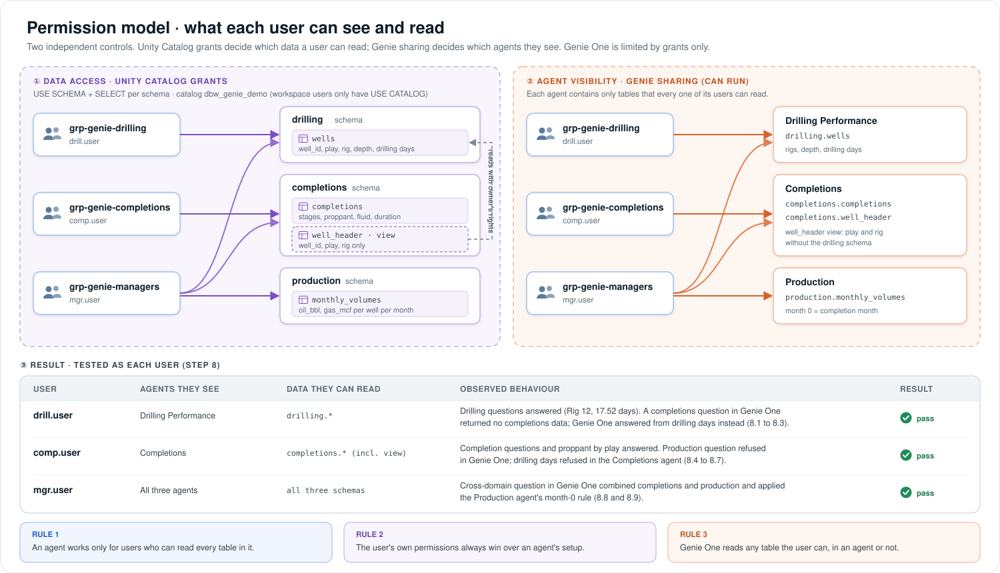
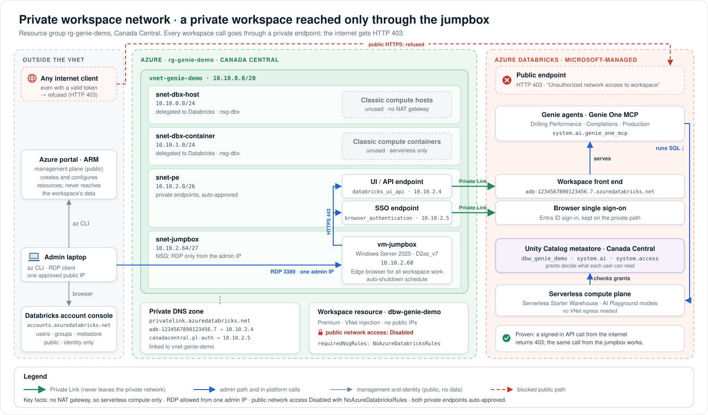
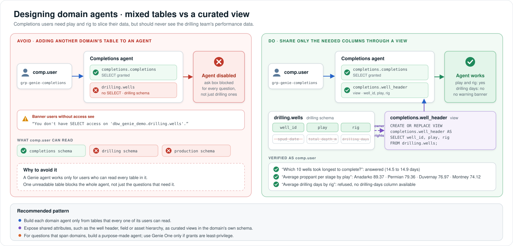
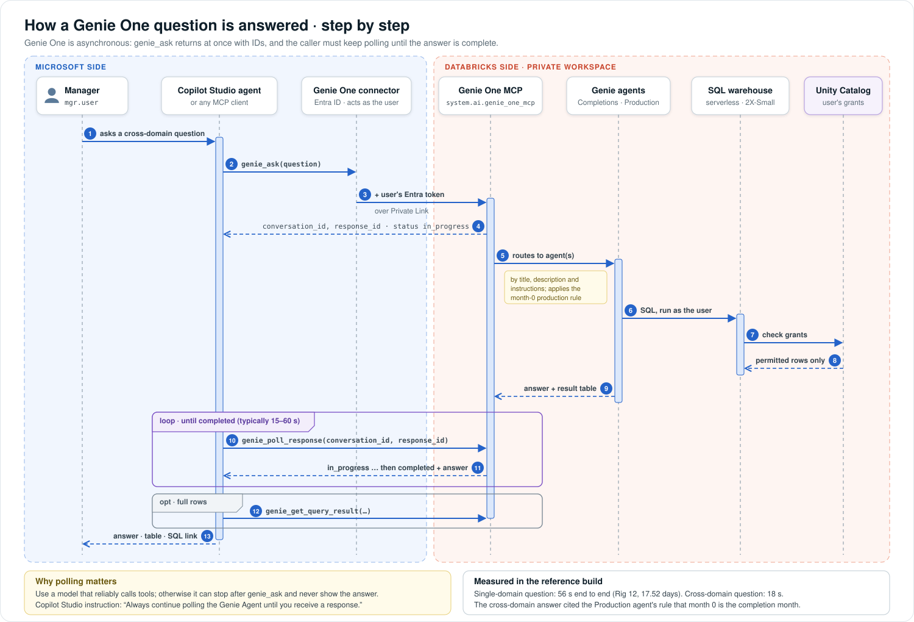

# Databricks build guide: domain Genie agents and Genie One on a private workspace

This guide builds the **Databricks side** of the design, step by step, from an empty, private, Unity Catalog-enabled
workspace. It explains why each step matters and what result to expect. It also describes what to do to avoid
the common pitfalls.

- Runnable SQL is in [`../sql`](../sql).
- Agent settings are in [`../genie-agents/agents.md`](../genie-agents/agents.md).
- Diagrams are in [`diagrams.md`](diagrams.md).
- All names, URLs and IP addresses are **example values**. Replace them with your own.

**Contents**
1. [What you are building and why](#1-what-you-are-building-and-why)
2. [Prerequisites: the private workspace](#2-prerequisites-the-private-workspace)
3. [Identities: users, groups and workspace access](#3-identities-users-groups-and-workspace-access)
4. [Compute: serverless SQL warehouse](#4-compute-serverless-sql-warehouse)
5. [Data: domain schemas, grants and descriptions](#5-data-domain-schemas-grants-and-descriptions)
6. [Genie agents](#6-genie-agents)
7. [Genie One and its MCP server](#7-genie-one-and-its-mcp-server)
8. [Verify as each user](#8-verify-as-each-user)
9. [Best practices](#9-best-practices)
10. [Common pitfalls and how to avoid them](#10-common-pitfalls-and-how-to-avoid-them)

---

## 1. What you are building and why

### The goal
Business users should reach curated **domain Genie agents** from Microsoft 365 Copilot in two ways:

- **Directly.** A specialist opens the one agent built for their work.
- **Through one entry point.** A manager asks anything, and **Genie One** decides which agent or data answers it.

This guide builds everything that makes that possible inside Databricks. Connecting Copilot is covered in guides 02–05, starting with
[02-prerequisites-licensing-and-billing.md](02-prerequisites-licensing-and-billing.md).

### Building blocks

| Building block | In this example | Why it matters |
|---|---|---|
| Domain data | Three schemas of **synthetic** data for a fictional energy company: `drilling`, `completions`, `production` | One schema per domain gives a clean permission boundary |
| Domain agents | **Drilling Performance**, **Completions**, **Production** | Curated, domain-specific Genie agents that specialists use directly |
| Single entry point | **Genie One**, exposed as the MCP server `system.ai.genie_one_mcp` | What Copilot, or any MCP client, calls |
| Permission model | One Entra group per domain plus a managers group; Unity Catalog grants per schema; agent sharing per group | Each user sees only what they are allowed to see |
| Private network | Workspace with **public network access disabled**, reached only through private endpoints | Keeps the workspace off the internet |

### How permissions work in Genie
Genie has no data access of its own. Genie, including Genie One, **runs every SQL query as the signed-in user**, so
**Unity Catalog grants are the only real security boundary**. Two further things shape what a question can reach:

1. **Agent sharing ("Can Run")** decides which agents a user can *see* and open.
2. **An agent's tables (Resources)** limit what *that agent* answers from. An agent can only **narrow** what a user
   reaches; it can never widen it.

**Genie One isn't limited by agents.** It routes to the agents a user can open, but it can also **query any table the
user can read directly**, even a table that isn't in any agent. Agent sharing and agent scope don't restrict it.

| User can read the table? | Table in an agent the user can use? | Asked through | Result |
|---|---|---|---|
| ✅ Yes | ✅ Yes | Agent | Answers |
| ✅ Yes | ✅ Yes | Genie One | Answers, through the agent and its business rules |
| ✅ Yes | ❌ No | Agent | Refuses: data not in this agent |
| ✅ Yes | ❌ No | Genie One | ⚠️ Answers by querying the table directly |
| ❌ No | ✅ Yes (agent shared with the user) | Agent | Agent disabled for that user (*no SELECT access* banner) |
| ❌ No | ✅ Yes | Genie One | No data returned |

So whatever a user can read is reachable through Genie One, and through any client that calls it, such as the
Copilot agent in this repository. Keep grants least-privilege (section 5.4), or connect clients to individual agents
instead ([07-design-decisions.md, D2](07-design-decisions.md#d2-entry-point-genie-one-vs-one-tool-per-genie-space)).



---

## 2. Prerequisites: the private workspace

The infrastructure must already exist before you start. This guide doesn't create it, but these are the properties it needs.



| Item | Example value | Notes |
|---|---|---|
| Tenant | `contoso.onmicrosoft.com` | Keep Microsoft 365, Power Platform and Databricks in the **same Entra tenant**. Per-user OAuth from Copilot needs it. |
| Region | Canada Central | Choose a region where serverless SQL and Genie are available |
| Resource group | `rg-genie-demo` | Keeping everything in one group makes clean-up easy |
| VNet | `vnet-genie-demo` (10.10.0.0/20) | Host 10.10.0.0/24 and container 10.10.1.0/24, both delegated to Databricks; `snet-pe` 10.10.2.0/26; `snet-jumpbox` 10.10.2.64/27 |
| Workspace | `dbw-genie-demo` | **Premium**, VNet-injected, secure cluster connectivity (no public IPs on compute) |
| Public network access | **Disabled**, with required NSG rules `NoAzureDatabricksRules` | Azure requires `NoAzureDatabricksRules` when public access is off |
| Private endpoints | `databricks_ui_api` (10.10.2.4) and `browser_authentication` (10.10.2.5) | The first serves the workspace website and REST API. The second keeps single sign-on working while public access is off. |
| Private DNS | `privatelink.azuredatabricks.net`, linked to the VNet | `adb-1234567890123456.7` → 10.10.2.4, `canadacentral.pl-auth` → 10.10.2.5 |
| Workspace URL | `https://adb-1234567890123456.7.azuredatabricks.net` | Resolves to the private IP only inside the VNet |
| Admin access | `vm-jumpbox`, a Windows VM inside the VNet | Do all workspace work from this VM's browser. Allow remote desktop from approved admin IPs only. |
| Outbound internet for classic compute | None (no NAT gateway) | Use **serverless compute**, which needs no VNet egress |

### Check the workspace is private
Do the check with a **signed-in** request. An unauthenticated request is rejected before the network check, so it proves nothing.

From a machine **outside** the VNet, call `/api/2.0/clusters/list` with a valid Entra token. Expected result:

```text
HTTP 403
Unauthorized network access to workspace: 1234567890123456
```

### Check the private path from the jumpbox
```powershell
nslookup adb-1234567890123456.7.azuredatabricks.net
# expected: resolves through privatelink.azuredatabricks.net to 10.10.2.4
```
Then open the workspace URL in the jumpbox browser and sign in.

---

## 3. Identities: users, groups and workspace access

### 3.1 Create users and groups in Entra ID
Use three personas so you can show that each person sees different data. Give each user a Microsoft 365 licence that includes Teams, because you'll need it for the Copilot phase.

| User | Group | Should be able to read |
|---|---|---|
| `drill.user@contoso.onmicrosoft.com` | `grp-genie-drilling` | Drilling only |
| `comp.user@contoso.onmicrosoft.com` | `grp-genie-completions` | Completions only |
| `mgr.user@contoso.onmicrosoft.com` | `grp-genie-managers` | Everything |

**Grant to groups, not individuals.** Adding or removing a person in Entra then changes their Databricks access automatically, with nothing to edit in Databricks.

Keep test passwords out of source control.

### 3.2 Add the groups to the workspace
An Entra group must be **added to the workspace** before it can receive permissions there. Otherwise, permission dialogs won't find it.

On the jumpbox, as workspace admin:
1. Click your avatar (top right) → **Settings** → **Workspace admin** → **Identity and access**.
2. Next to **Groups**, click **Manage** → **Add group**.
3. Search for each group and add `grp-genie-drilling`, `grp-genie-completions` and `grp-genie-managers`. With **automatic identity management**, which is on by default for new accounts, Entra groups appear directly in the search.
4. Check the Groups page. Each group shows **Source: External**, meaning its membership is managed in Entra ID.
5. Open each group → **Entitlements** tab → tick **Workspace access** and **Databricks SQL access** → **Save**.

If the search returns no Entra groups, turn on **Automatic identity management** in the account console (`https://accounts.azuredatabricks.net`) → **Settings**.

**Why these entitlements:**
- **Workspace access** lets users open the workspace, including Genie Agents and Databricks One.
- **Databricks SQL access** lets their Genie queries run on SQL warehouses.

---

## 4. Compute: serverless SQL warehouse

Genie needs a **Pro or serverless SQL warehouse** to run the SQL it generates. New workspaces include a
**Serverless Starter Warehouse**, which is enough here.

Go to **Compute → SQL warehouses → Serverless Starter Warehouse → Edit**:

| Setting | Value | Why |
|---|---|---|
| Type | Serverless | Runs in Databricks' serverless environment. Needs no VNet egress or VM quota. |
| Cluster size | **2X-Small** | Plenty for this sample data |
| Auto stop | **10 minutes** | Keeps cost low |
| Scaling | Min 1, max 1 | No scale-out needed |

**Permissions:** by default, **All workspace users** have **Can use**. Users added through groups are workspace users, so no extra warehouse permission is needed.

---

## 5. Data: domain schemas, grants and descriptions

Run everything in this section in the **SQL Editor** on the serverless warehouse.

### 5.1 Find the catalog
```sql
SHOW CATALOGS;
```
Expected: the **workspace catalog**, named after the workspace with hyphens turned into underscores (`dbw_genie_demo`), plus `samples` and `system`.

Using the workspace catalog avoids having to set up a storage credential and external location for a new catalog.
For production, use dedicated catalogs with their own managed storage.

### 5.2 Create the domain schemas and synthetic tables
- **One schema per domain.** In Unity Catalog the schema is the natural permission boundary, so each group can be granted exactly its own domain.
- **Shared keys.** `completions` is built from `drilling.wells`, and `production` from `completions`, so `well_id` joins line up across domains. That's what makes cross-domain questions answerable.

Full script: [`sql/01_schemas_and_tables.sql`](../sql/01_schemas_and_tables.sql). Run it with **Run all**.

```sql
USE CATALOG dbw_genie_demo;

CREATE SCHEMA IF NOT EXISTS drilling    COMMENT 'Drilling operations (synthetic sample data)';
CREATE SCHEMA IF NOT EXISTS completions COMMENT 'Well completions (synthetic sample data)';
CREATE SCHEMA IF NOT EXISTS production  COMMENT 'Monthly production volumes (synthetic sample data)';

CREATE OR REPLACE TABLE drilling.wells COMMENT 'One row per well drilled' AS
SELECT concat('W-', lpad(cast(id AS STRING), 4, '0'))                                   AS well_id,
       element_at(array('Montney','Duvernay','Permian','Anadarko'), cast(id % 4 + 1 AS INT)) AS play,
       element_at(array('Rig 12','Rig 21','Rig 34'), cast(id % 3 + 1 AS INT))          AS rig,
       date_add(DATE'2024-01-01', cast(id * 3 AS INT))                                AS spud_date,
       round(2500 + rand(1) * 2500, 0)                                                AS total_depth_m,
       round(8 + rand(2) * 20, 1)                                                     AS drilling_days
FROM range(1, 201);

CREATE OR REPLACE TABLE completions.completions COMMENT 'One completion job per well' AS
SELECT well_id,
       date_add(spud_date, cast(drilling_days + 10 + rand(3) * 30 AS INT)) AS completion_date,
       cast(20 + rand(4) * 40 AS INT)                                     AS stage_count,
       round(1500 + rand(5) * 3500, 0)                                    AS proppant_tonnes,
       round(10000 + rand(6) * 30000, 0)                                  AS fluid_m3,
       round(3 + rand(7) * 12, 1)                                         AS completion_days
FROM drilling.wells;

CREATE OR REPLACE TABLE production.monthly_volumes COMMENT 'Monthly oil and gas volumes per well' AS
SELECT c.well_id,
       add_months(trunc(c.completion_date, 'MM'), m.id)       AS month,
       round((800 + rand(8) * 1200) * exp(-0.08 * m.id), 0)   AS oil_bbl,
       round((2000 + rand(9) * 4000) * exp(-0.06 * m.id), 0)  AS gas_mcf
FROM completions.completions c
CROSS JOIN range(0, 12) AS m;

SELECT 'wells' AS table_name, count(*) AS row_count FROM drilling.wells
UNION ALL SELECT 'completions', count(*) FROM completions.completions
UNION ALL SELECT 'monthly_volumes', count(*) FROM production.monthly_volumes;
```

**Expected:** wells **200**, completions **200**, monthly_volumes **2,400** (200 wells × 12 months).

| Table | Columns | Grain |
|---|---|---|
| `drilling.wells` | well_id, play, rig, spud_date, total_depth_m, drilling_days | One row per well |
| `completions.completions` | well_id, completion_date, stage_count, proppant_tonnes, fluid_m3, completion_days | One job per well |
| `production.monthly_volumes` | well_id, month, oil_bbl, gas_mcf | One row per well per month; month 0 is the completion month |

### 5.3 Create the shared reference view
Completions users need a well's **play** and **rig** to slice their data, but they shouldn't see drilling performance.
Expose just those columns through a **view in the completions schema**
([`sql/04_well_header_view.sql`](../sql/04_well_header_view.sql)):

```sql
USE CATALOG dbw_genie_demo;

CREATE OR REPLACE VIEW completions.well_header
COMMENT 'Reference attributes per well (well_id, play, rig) for completions analysis. Sourced from drilling.wells; excludes drilling performance columns.'
AS SELECT well_id, play, rig FROM drilling.wells;
```

**How it works:** a Unity Catalog view reads its underlying tables with the **view owner's** rights. Readers only need
`SELECT` on the view, never on `drilling.wells` itself.

Section 6.2 explains why the Completions agent should use this view rather than the drilling table.



### 5.4 Grant access by group
Full script: [`sql/02_grants.sql`](../sql/02_grants.sql).

```sql
USE CATALOG dbw_genie_demo;

GRANT USE CATALOG ON CATALOG dbw_genie_demo TO `grp-genie-drilling`;
GRANT USE CATALOG ON CATALOG dbw_genie_demo TO `grp-genie-completions`;
GRANT USE CATALOG ON CATALOG dbw_genie_demo TO `grp-genie-managers`;

GRANT USE SCHEMA, SELECT ON SCHEMA drilling    TO `grp-genie-drilling`;
GRANT USE SCHEMA, SELECT ON SCHEMA completions TO `grp-genie-completions`;
GRANT USE SCHEMA, SELECT ON SCHEMA drilling    TO `grp-genie-managers`;
GRANT USE SCHEMA, SELECT ON SCHEMA completions TO `grp-genie-managers`;
GRANT USE SCHEMA, SELECT ON SCHEMA production  TO `grp-genie-managers`;
```

- Databricks `GRANT` takes **one principal per statement**.
- `SELECT` on a **schema** covers every current *and future* table and view in it, including `completions.well_header`.

**Verify the grants:**
```sql
SELECT 'catalog' AS level, catalog_name AS object, grantee, privilege_type
FROM information_schema.catalog_privileges
UNION ALL
SELECT 'schema', schema_name, grantee, privilege_type
FROM information_schema.schema_privileges
WHERE schema_name IN ('drilling', 'completions', 'production')
ORDER BY level, object, grantee, privilege_type;
```

Expected:
- `drilling`: drilling and managers groups
- `completions`: completions and managers groups
- `production`: managers only

Each with `USE_SCHEMA` and `SELECT`.

**Also check catalog-level grants for everyone else.** The workspace catalog includes an auto-created group,
`_workspace_users_<workspace>_<id>`. Make sure it can't read every table, or the permission model is meaningless:
```sql
SELECT grantee, privilege_type
FROM information_schema.catalog_privileges
ORDER BY grantee, privilege_type;
```
**Expected:** `USE_CATALOG` only. That lets users see the catalog exists without reading any table.

**Make every readable table one you're happy to see in an answer.** Genie One answers from any table a user can read,
not just the tables in agents (section 1). In this build, each group's schemas contain only tables that are in that
group's agents. Before connecting Copilot to Genie One, review:
- **Broad grants:** catalog-level `SELECT`, grants to *All account users* or *users*, and the auto-created
  `_workspace_users_…` group.
- **Views owned by a privileged identity:** a view reads with its owner's rights (5.3), so granting it exposes the
  underlying data. Grant views deliberately.
- **Sensitive columns and rows:** use **row filters and column masks**. They apply everywhere, Genie included.

### 5.5 Write descriptions Genie can rely on
Genie reads **table and column descriptions** to understand the data. Clear descriptions are the cheapest way to
improve answers and Genie One's routing.

1. **Column comments.** In **Catalog Explorer**, open each table → **AI generate** for the columns → review → **Accept all**. Generated column comments are usually accurate; check units and meanings.
2. **Table comments.** Keep them **short and factual**: grain, units and join keys. Avoid long generated essays. Genie reads every word, and text about things that aren't in the data can mislead it ([`sql/03_table_comments.sql`](../sql/03_table_comments.sql)):

```sql
USE CATALOG dbw_genie_demo;

COMMENT ON TABLE drilling.wells IS
  'One row per well drilled (synthetic). Grain: well_id. Includes play (basin), rig, spud date, total depth in metres and drilling days.';

COMMENT ON TABLE completions.completions IS
  'One completion job per well (synthetic). Grain: well_id. Includes completion date, stage count, proppant in tonnes, fluid in cubic metres and completion duration in days. Join to completions.well_header on well_id for play and rig.';

COMMENT ON TABLE production.monthly_volumes IS
  'Monthly production per well for the first 12 months after completion (synthetic). Grain: well_id + month. oil_bbl is barrels of oil, gas_mcf is thousand cubic feet of gas.';
```

---

## 6. Genie agents

Create each agent under **Genie Agents → New**:
1. Select the tables → **Create**.
2. Under **Configure**, fill in:
   - **About:** name, description and warehouse
   - **Resources:** tables
   - **Instructions**
   - **Common questions**
3. Under **Share**, add the groups with **Can Run**.

The copy-paste configuration is in [`../genie-agents/agents.md`](../genie-agents/agents.md).

**Give every agent a clear business title and description.** Genie One and Copilot choose agents from them. Genie
suggests a title from the table names; always replace it.

**End every set of instructions with "answer only from the tables in this agent".** The agent then says when data is
missing instead of guessing. The agent's **Resources** are what actually limit it; the instruction only gives users a
clear message.

**Check Resources lists every table the instructions mention.** Genie can only query tables added as resources.

### 6.1 Drilling Performance

| Setting | Value |
|---|---|
| Tables | `drilling.wells` |
| Description | Drilling performance by well: rig, play, spud date, total depth and drilling days. |
| Shared with (Can Run) | `grp-genie-drilling`, `grp-genie-managers` |

Instructions:
```text
Depths are in metres. Drilling time is in days. A well is identified by well_id.
"Play" means the basin or formation (Montney, Duvernay, Permian, Anadarko).
Answer only from the tables in this agent; if a question needs other data, say so.
```

**Verify:** ask *"Which rig has the lowest average drilling days?"* Expected: **Rig 12, 17.52 days (66 wells)**, then Rig 34 at 17.59 and Rig 21 at 17.96. Genie uses `wells` with a `GROUP BY rig` query.

### 6.2 Completions

| Setting | Value |
|---|---|
| Tables | `completions.completions`, `completions.well_header` |
| Description | Completion jobs by well: stage count, proppant, fluid volume and completion duration. |
| Shared with (Can Run) | `grp-genie-completions`, `grp-genie-managers` |

Instructions:
```text
Proppant is in tonnes, fluid in cubic metres, completion duration in days.
Join completions to completions.well_header on well_id when play or rig is needed.
Answer only from the tables in this agent; if a question needs other data, say so.
```

**Build each agent only from tables that every user of the agent can read.** Genie disables an agent entirely for a
user who can't read even one of its tables. That user sees the banner *"You don't have SELECT access on …"* and
can't ask anything at all. That's why this agent uses the `well_header` view in the completions schema rather than
`drilling.wells`.

**Verify (as admin and as `comp.user`):** ask *"What is the average proppant per stage by play?"* Expected:
- Anadarko 89.37, Permian 79.36, Duvernay 76.97 and Montney 74.12 tonnes per stage
- 50 wells per play

Genie may also offer two calculation methods: pooled, and per-well average.

### 6.3 Production

| Setting | Value |
|---|---|
| Tables | `production.monthly_volumes` |
| Description | Monthly oil and gas production volumes and decline by well, for the first 12 months after completion. |
| Shared with (Can Run) | `grp-genie-managers` **only** |

Instructions:
```text
oil_bbl is barrels of oil, gas_mcf is thousand cubic feet of gas. One row per well per month.
Month 0 is the completion month. "Decline" means the percentage drop from a well's first month.
Answer only from the tables in this agent; if a question needs other data, say so.
```

**Verify:** ask *"Which 10 wells produced the most gas in their first 3 months?"* Expected: W-0103 at 15,855 mcf,
W-0087 at 15,737, W-0042 at 15,509, and so on.

**Treat the result table and SQL as the source of truth.** Genie's written summary is generated text and can
occasionally misquote a number. Teach users to check the table.

**Optional: add example SQL.** The **Examples** tab takes example SQL queries. Adding a few improves accuracy and the
agent's quality indicator (the small bars next to its name).

---

## 7. Genie One and its MCP server

### 7.0 Make Genie One available to users
- **Workspace-level Genie One** (used by this design) has no separate switch. Every workspace member with at least
  one workspace entitlement (for example **Workspace access**, **Databricks SQL access** or **Consumer access**) can
  use it at `https://adb-1234567890123456.7.azuredatabricks.net/one`. The groups from section 3 already qualify.
- **Account-level Genie One** is controlled by account admins in the account console → **Settings → Feature
  enablement → Genie**. It isn't needed for this design.
- Users only see Genie spaces shared with them and only read data granted to them (sections 5 and 6). Genie One
  can use those spaces **and query any other table the user can read directly** (section 1).

[Enable Genie One for users](https://learn.microsoft.com/en-us/azure/databricks/genie-one/enable-genie-one)

### 7.1 Turn on the preview you need
Avatar → **Previews**. Turn on only what the design needs, so each result has one clear cause:

| Preview | Setting | Reason |
|---|---|---|
| **Managed MCP Servers** | **Off** | Not needed for Genie One. It enables only the per-space Genie, SQL, AI Search and Unity Catalog function MCP endpoints (also used by the Azure Databricks connector's per-space Genie tool). Verified: with it off, those endpoints return *"Databricks managed MCP servers are not enabled"*, while Genie One and the Copilot agent keep working. |
| MCP tools in Genie Agents | Off | Lets agents call third-party services such as Gmail, SharePoint and Slack. Out of scope, and it adds outbound connections. |
| Unity Gateway Service Policies | Off | Not needed |
| Genie Agents Flash Mode | Off | Changes how agents answer. Keep the standard behaviour for consistent results. |
| Genie Code Tracing | Off | Traces the coding assistant, not Genie agents |
| Genie One API | Off unless needed | REST access to Genie One, for building a custom router |
| Genie One Tracing | Optional | Shows *why* Genie One picked an agent. Needs a trace table set up first. |

**The Genie One MCP server itself is generally available.** It has no preview toggle.

Preview changes can take a few minutes to take effect. Refresh open pages (Ctrl+F5) before using a new feature.

### 7.2 The MCP service object
Go to **Catalog → system → ai → Services → `genie_one_mcp`**.

- **Endpoint:** `https://adb-1234567890123456.7.azuredatabricks.net/ai-gateway/mcp-services/system.ai.genie_one_mcp`
  - Use this address, not the Beta endpoint `/api/2.0/mcp/genie`, which reaches end of life on **30 November 2026**.
  - OAuth clients request the `ai-gateway` scope.
- **Tools:**

| Tool | Purpose |
|---|---|
| `genie_ask` | Ask a natural-language question. Starts a Genie conversation and returns at once with IDs. |
| `genie_poll_response` | Read-only. Fetch the latest state of an answer. Call it until the status is completed. |
| `genie_get_query_result` | Read-only. Fetch the full SQL result rows for an answer. |
| `genie_cancel_response` | Stop an answer that is still being generated |

The page also has a **Get started** panel with cURL, Python, SDK and IDE examples, plus **Try in Playground**.

The same Services list includes third-party connectors (GitHub, Gmail, Google Drive, Microsoft 365, Slack and others).
Leave them unused unless your design needs them.

### 7.3 Permissions on Genie One
By default, **All account users** have `EXECUTE` on `system.ai.genie_one_mcp`, inherited from `system.ai`. They also
have `USE CATALOG` on `system` and `USE SCHEMA` on `system.ai`. Check with:

```sql
SHOW GRANTS ON CATALOG system;    -- account users: USE CATALOG
SHOW GRANTS ON SCHEMA system.ai;  -- account users: EXECUTE, READ VOLUME, SELECT, USE SCHEMA
```

- Every user can call Genie One without extra grants.
- **What they get back is limited by Unity Catalog grants only.** Agent sharing decides which agents Genie One can
  route to for the user, but Genie One can still query any table the user can read without an agent.
- To limit Genie One to specific users, a metastore admin takes `MANAGE` on `system.ai`, revokes the inherited `EXECUTE` from all account users, and grants it to chosen groups.

Changing grants on this object needs `MANAGE`; without it, the **Grant** button is greyed out.

### 7.4 Test Genie One in AI Playground
1. On the `genie_one_mcp` page, click **Try in Playground**. Or go to Playground → **Tools** → **Add tool** → **MCP Servers** → `system.ai.genie_one_mcp` → **Save**.
2. Check that **Tools (1)** shows *UC MCP Service: system.ai.genie_one_mcp*.
3. Pick a model that reliably calls tools. A Databricks-hosted model such as **Meta Llama 3.3 70B Instruct** works.
   New Databricks accounts may restrict partner-hosted models until the account is verified, even with partner-powered AI features on. If a model returns `PERMISSION_DENIED: Access to this model is disabled`, pick a Databricks-hosted model.

**Test 1, single domain:** *"Which rig has the lowest average drilling days?"*
- **Routing:** the tool output shows **"Genie: Drilling Performance"**. Genie One chose the agent on its own.
- **Answer:** Rig 12, 17.52 days, 66 wells, with an **Explore in Databricks** link to the conversation in Databricks One.
- **Typical time:** under a minute end to end.

**Test 2, cross-domain:** *"For the 10 wells with the highest proppant per stage, what was their total oil production in the first 3 months?"*
- **Answer:** 10 wells, with proppant per stage from completions and 3-month oil from production. W-0166 has the most proppant per stage (about 237 t, 4,106 bbl), and W-0131 produced the most oil (4,657 bbl).
- **Curated rules:** the answer explains *"First 3 months means the completion month plus the next two months. This follows the Production Genie space, which counts the completion month as month 0."* So Genie One applies each domain agent's own instructions.
- **Typical time:** 15–20 seconds.

**Keep polling until the answer is complete.** Genie One is asynchronous: `genie_ask` returns at once, and the caller
must keep calling `genie_poll_response` until the status is completed.
- If the model stops early, or prints a tool call as text instead of running it, the answer never appears.
- In that case, ask it to continue polling, or open **Explore in Databricks**.
- Copilot Studio agents need the instruction *"Always continue polling the Genie Agent until you receive a response."*



---

## 8. Verify as each user

Use an **InPrivate** browser window on the jumpbox for each user, and close it between users. Test agents under
**Genie Agents**, and Genie One at `https://adb-1234567890123456.7.azuredatabricks.net/one` (Databricks One chat).

| # | User | Where | Action or question | Expected result |
|---|---|---|---|---|
| 8.1 | drill.user | Genie Agents | View the list | Only Drilling Performance |
| 8.2 | drill.user | Drilling Performance | Which rig has the lowest average drilling days? | Rig 12, 17.52 days (66 wells) |
| 8.3 | drill.user | Genie One | Which 10 wells took longest to complete? | **No completions data.** Genie One answers from what the user can read (drilling days) and says completion data isn't available to them. |
| 8.4 | comp.user | Genie Agents | View the list | Only Completions |
| 8.5 | comp.user | Completions | Which 10 wells took longest to complete? | 10 wells at 14.5–14.9 completion days, with a chart |
| 8.6 | comp.user | Completions | Average proppant per stage by play? | Four plays, same values as the admin, through `well_header` |
| 8.6b | comp.user | Completions | Average drilling days by rig? | Refused: no drilling-days column is available |
| 8.7 | comp.user | Genie One | What is total oil production by month? | Refused: none of the user's data includes oil volumes. Genie One lists what it checked. |
| 8.8 | mgr.user | Genie Agents | View the list | All three agents, with no warning banner |
| 8.9 | mgr.user | Genie One | Top 10 wells by proppant per stage, oil in the first 3 months | Full cross-domain answer using the Production agent; the same wells as the admin test |

All tests pass in the reference build.

**What these tests show:**
- **No data outside a user's grants is ever returned**, whether through a domain agent or Genie One.
- **A user's permissions override an agent's configuration.** An agent containing a table the user can't read is disabled for that user, which is why domain agents must use only readable tables.
- **Genie One isn't limited to agents.** These tests pass because every table each user can read is in one of their
  agents. If a user can read a table that's in none of their agents, Genie One answers from it directly, while the
  agents refuse (section 1). Add that case to your own tests whenever grants are broader than the agents.
- **Genie One may answer a related question** rather than refuse outright (8.3). No data leaks, but add a workspace-level instruction so users are told more clearly when data exists that they can't access (see section 9). Instructions shape wording only; they don't control access.
- **Agent instructions are visible to everyone with Can Run**, and Genie One may quote table names from them (8.7). Keep instructions free of sensitive information.

---

## 9. Best practices

1. **Build domain agents only from tables every user of that agent can read.** Expose shared reference attributes, such as a well header, customer master or product hierarchy, through curated **views in the domain's own schema**.
2. **Choose how cross-domain questions are answered.** Genie One combines whatever each user may read and applies each
   agent's curated instructions when it routes through an agent. But it also answers from readable tables outside any
   agent, without curation. Use it only when grants are least-privilege. Otherwise build **purpose-made agents** that
   contain the tables a cross-domain question needs.
3. **Invest in titles, descriptions and instructions.** Genie One and Copilot route on them.
   - Replace suggested titles with clear business names.
   - Keep table descriptions short and factual: grain, units, join keys.
4. **Keep sensitive information out of agent instructions.** Every user with Can Run can read them.
5. **Add a workspace-level Genie One instruction** under Genie One → Customizations, for example: *"If a question needs data the user cannot see, say the data may exist but they don't have access, and suggest who to contact."*
   Use these instructions for terminology and clear "not available" messages only. **They aren't access control.** An
   instruction such as *"answer only through agents"* was tested and isn't enforced: one run answered from the table
   directly, a repeat run refused. No Genie One admin setting limits its chat to agents either.
6. **Treat the result table and SQL as the source of truth**, and teach users to check them.
7. **Plan for asynchronous answers** of roughly 15–60 seconds, and make sure every calling agent keeps polling.
8. **Know the default access to Genie One.** All account users can call it, and Unity Catalog alone governs what they get: it can reach every table they can read. Restrict `EXECUTE` on `system.ai.genie_one_mcp` only if Genie One itself must be limited.
   For a stronger boundary, give business users a separate workspace **bound to curated catalogs only** (catalog-workspace
   binding), so Genie One there can't reach raw data. They keep their grants in the engineering workspaces.
9. **Use the GA Genie One endpoint**, `/ai-gateway/mcp-services/system.ai.genie_one_mcp` with a Microsoft Entra ID user token (resource AzureDatabricks, used by the Copilot connector in this repository) or Databricks OAuth with the `ai-gateway` scope. The Beta `/api/2.0/mcp/genie` endpoint ends on **30 November 2026**.
10. **Grant to groups, synced from Entra ID,** so access follows organisational changes automatically.
11. **Define joins and formatting once per space** (Configure → Instructions), for example:
    ```text
    Show averages and ratios with 2 decimal places; show volumes as whole numbers with thousands separators.
    Only create a chart when the result has more than 5 rows or is a time series; otherwise show a table.
    "First 3 months" means the completion month (month 0) plus the next two months.
    ```
    Add the joins under **Joins** (for example `completions.well_header.well_id = completions.completions.well_id`).
12. **Add 3–5 trusted example SQL queries per space** (Configure → Instructions → **SQL queries**) for the questions
    asked most often. This is the most effective way to make answers consistent.
13. **Use benchmarks.** Add the test questions with their expected answers (Benchmarks tab) and run them after every
    change to a space.
14. **Review the Monitoring tab weekly** (questions, failed answers, feedback) and turn poor answers into new trusted
    examples or instructions.
15. **Keep refusals free of schema details.** Add to the Genie One workspace instruction (best practice 5): *"Do not
    describe tables or columns the user cannot see. Answer only the current question."*

---

## 10. Common pitfalls and how to avoid them

| Do this | Otherwise |
|---|---|
| Test that the workspace is private with a **signed-in** request from outside the VNet | An unauthenticated request returns 401 or a login redirect, which says nothing about network access |
| **Add Entra groups to the workspace** (Settings → Identity and access) before granting them anything | Permission dialogs can't find the group ("No results found") |
| Turn on **automatic identity management** in the account console | Entra groups don't appear when you search in the workspace |
| Give groups **Workspace access** and **Databricks SQL access** | Users can't open Genie, or their queries can't run on the warehouse |
| Build each agent **only from tables all its users can read**; share extra columns through a view | The agent is disabled for any user missing one table's `SELECT`, with a warning banner and no way to ask |
| Keep **grants as narrow as the agents** if users reach Genie One (or connect individual agents instead) | Genie One answers from any readable table, uncurated, even one that's in no agent |
| Treat Genie One instructions as **wording only** | An "agents only" instruction isn't enforced and behaves differently from run to run |
| **Add every table the instructions mention** under Configure → Resources | Genie answers that the data "isn't available to me" |
| Keep **table descriptions short and factual** | Long generated text about things not in the data can mislead Genie |
| Replace **suggested agent titles** with clear business names | Genie One and Copilot route questions to the wrong agent |
| **Refresh** open pages after turning on a preview | Playground can keep saying the feature isn't enabled |
| Use a **Databricks-hosted model** in Playground on a new account | Partner-hosted models can return `PERMISSION_DENIED` until the account is verified |
| Instruct the calling model to **keep polling** `genie_poll_response` | The conversation stops after `genie_ask` and the answer never appears |
| Check the **result table and SQL**, not only the summary | A generated summary can misquote a number |
| Grant `MANAGE` on `system.ai` before changing Genie One permissions | The Grant button stays greyed out |

---

**Next:** check the prerequisites, licences and billing in [02-prerequisites-licensing-and-billing.md](02-prerequisites-licensing-and-billing.md), then build the private path in [03-private-connectivity-power-platform-vnet.md](03-private-connectivity-power-platform-vnet.md).
