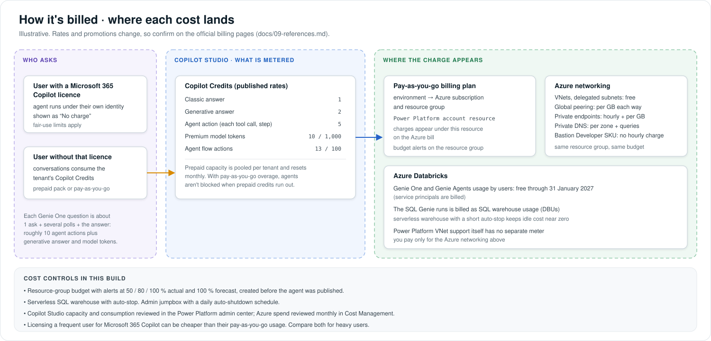

# 2. Prerequisites, licences, permissions and billing

Read this before you build the Microsoft side. It lists what must already exist, which licences each person needs,
which admin role each step requires, and how every component is billed. All names are example values.

> **Official references** are linked in each section and collected in [09-references.md](09-references.md).
> Licensing and pricing change over time. Confirm current terms on the linked pages before you buy.

---

## 2.1 Prerequisites checklist

| # | Prerequisite | Why it matters | How to check |
|---|---|---|---|
| P1 | **One Microsoft Entra tenant** for Microsoft 365, Power Platform and Azure Databricks | Per-user sign-in (each query runs as the user) only works when the same Entra identity is known to all three. Across tenants you can only use a service principal, and then every user shares its access. | Entra admin center → Overview: one tenant ID for all three services |
| P2 | **Databricks side built and verified**: Unity Catalog grants per group, Genie spaces shared per group, Genie One enabled | Copilot only exposes what Databricks already allows. Build and test this first, as in [01-databricks-build-guide.md](01-databricks-build-guide.md). | Each test user gets the expected answer in the Databricks UI |
| P3 | **Workspace on Premium tier, VNet-injected, with Private Link** (front-end private endpoint `databricks_ui_api` and `browser_authentication`) | The private path ends at the workspace's private endpoint. | Azure portal → workspace → Networking |
| P4 | **Private DNS zone** `privatelink.azuredatabricks.net` linked to the workspace VNet | Clients inside the VNet must resolve the workspace URL to the private endpoint IP. | `Resolve-DnsName adb-…azuredatabricks.net` from a VM in the VNet returns `10.10.2.4` |
| P5 | **Genie One MCP server** reachable, and the users have `EXECUTE` on `system.ai.genie_one_mcp` (inherited by all account users by default). The **Managed MCP Servers preview is not required**: Genie One is generally available and was verified with the preview turned off. | The agent calls only Genie One. | Catalog Explorer → `system` → `ai` → Services → `genie_one_mcp` → Permissions; or `tools/list` on the endpoint returns the Genie tools |
| P6 | **An Azure subscription linked to the tenant**, with rights to create resources | Needed for Power Platform VNet support, the pay-as-you-go billing plan, budgets and locks. | Azure portal → Subscriptions |
| P7 | **Security groups** for the users of the agent (for example `grp-genie-copilot-users`) and one group per data domain | Access is granted to groups, never to individuals. | Entra admin center → Groups |
| P8 | **Same Azure geography** for the Power Platform environment and the Databricks workspace | Power Platform VNet support needs delegated subnets in the environment's region pair. Keeping both in one geography keeps traffic and data residency simple. | Example: Power Platform region *Canada* ↔ Azure *Canada Central* + *Canada East* |

## 2.2 Licences

### People

| Who | Licence | Why | Reference |
|---|---|---|---|
| **End users** chatting with the agent in Teams or Microsoft 365 Copilot | A Microsoft 365 licence that includes Teams. **Optional:** a Microsoft 365 Copilot licence. | With a Microsoft 365 Copilot licence, usage of an agent that runs under the user's own authenticated identity is shown as **"No charge"** in the Copilot Studio billing table (fair-use limits apply). Without it, the user's conversations consume Copilot Credits from the tenant (prepaid packs or pay-as-you-go). | [Billing rates and management](https://learn.microsoft.com/en-us/microsoft-copilot-studio/requirements-messages-management) |
| **Makers** who build the agent | A **Copilot Studio user licence** (free, assigned by an admin once the tenant has Copilot Studio capacity), or a Microsoft 365 Copilot licence | A **trial** licence lets you build and test in the test pane, but **you can't publish**. | [Copilot Studio licensing](https://learn.microsoft.com/en-us/microsoft-copilot-studio/billing-licensing) |
| **Databricks users** (every end user) | Workspace user with the **Workspace access** and **Databricks SQL access** entitlements, `CAN USE` on the SQL warehouse, and access to the Genie spaces | Genie runs SQL as the user on a SQL warehouse. | [Genie](https://learn.microsoft.com/en-us/azure/databricks/genie/) |

### Platform capacity

| Component | What you need | Notes |
|---|---|---|
| **Copilot Studio capacity** | Copilot Credits from **pay-as-you-go** (an Azure subscription), a **prepaid pack**, or a **prepurchase plan** | Pay-as-you-go needs no upfront commitment. When an environment bills overage to pay-as-you-go, running out of prepaid credits doesn't block its agents. |
| **Managed Environment** | Included as an entitlement with standalone Power Apps, Power Automate, Copilot Studio, Power Pages and Dynamics 365 licences | Required for Power Platform VNet support, sharing limits and other governance features. [Managed environments overview](https://learn.microsoft.com/en-us/power-platform/admin/managed-environment-overview) |
| **Dataverse** | Created with the environment | Copilot Studio stores agents, connection references and settings in Dataverse. |
| **Azure Databricks** | Premium tier | Private Link, IP access lists and Unity Catalog features used here require Premium. |

## 2.3 Admin roles needed, step by step

Use the least privilege that works. One Global Administrator *can* do everything, but production change control
usually splits these roles.

| Step | Where | Minimum role |
|---|---|---|
| Create the Power Platform environment, make it Managed, add the billing plan | Power Platform admin center | **Power Platform Administrator** |
| Create the pay-as-you-go billing plan | Power Platform admin center + Azure | Power Platform Administrator **and** Owner or Contributor on the Azure subscription or resource group |
| Register the `Microsoft.PowerPlatform` resource provider | Azure subscription | Contributor or Owner on the subscription |
| Create the delegated subnets, VNet peering, DNS link | Azure | **Network Contributor** on the VNets (Private DNS Zone Contributor for the DNS link) |
| Create the enterprise policy (subnet injection) | Azure | Contributor on the resource group plus Network Contributor on the VNets |
| Link the enterprise policy to the environment | Power Platform | Power Platform Administrator, with at least **Reader** on the enterprise policy |
| Register the Entra app, add the federated credential, grant admin consent, set "Assignment required" | Entra admin center | **Cloud Application Administrator** or **Application Administrator** (admin consent for delegated permissions may need **Privileged Role Administrator** or Global Administrator, depending on your consent policy) |
| Create the solution and the custom connector, and share the connector | Power Apps (maker portal) | Environment Maker in the environment (System Customizer to create a solution publisher) |
| Create the Dataverse group team used for sharing | Power Platform admin center | System Administrator in the environment |
| Data policy (DLP) | Power Platform admin center | Power Platform Administrator |
| Create and publish the Copilot Studio agent | Copilot Studio | Environment Maker (and a Copilot Studio maker licence) |
| Databricks grants, Genie spaces, Genie One | Databricks | Workspace admin; metastore admin or object owner for Unity Catalog grants |
| Resource locks and budgets | Azure | Owner or User Access Administrator (locks); Cost Management Contributor (budgets) |

## 2.4 How billing works

| Component | What is billed | Where the charge appears | How to control it |
|---|---|---|---|
| **Copilot Studio agent** | **Copilot Credits.** Per the published rates: a classic answer is 1 credit, a generative answer 2, an agent action (each tool call and orchestration step) 5. The connector option changes the number of tool calls per question (see the measured examples below). Reasoning models are also billed per 1,000 tokens at the premium rate. | With pay-as-you-go: under the **Power Platform account resource** (the billing plan, for example `pp-billing-genie-demo`) in your Azure subscription and resource group | Budget alerts on the resource group; Copilot Studio capacity reports in the Power Platform admin center |
| **Users with a Microsoft 365 Copilot licence** | Shown as **"No charge"** when the agent runs with the user's authenticated identity (fair-use limits apply) | — | Licence assignment |
| **Power Platform VNet support** | No separate meter. You pay for the Azure networking you create. | Azure | — |
| **Azure networking** | VNets and delegated subnets: no charge. **Global VNet peering:** per GB in each direction. Private endpoints: per hour plus per GB. Private DNS zone: per zone per month plus per query. | Azure resource group | Keep traffic within one geography |
| **Azure Bastion (optional, admin access)** | The **Developer** SKU has no hourly charge; Basic and Standard are billed hourly | Azure | Use Developer for labs; review the SKU for production |
| **Admin jumpbox (optional)** | VM compute and disk | Azure | Auto-shutdown schedule |
| **Azure Databricks Genie** | **Genie One and Genie Agents usage by users is free through 31 January 2027** (service principals are billed). The SQL that Genie generates runs on your **SQL warehouse**, billed in DBUs. | Azure Databricks charges | Serverless warehouse with a short auto-stop; Genie budgets in the account console |
| **Dataverse** | Database, file and log capacity | Power Platform capacity, or pay-as-you-go | Auditing retention settings |

> Copilot Studio has two agent **harnesses** (Microsoft Copilot and standard) with different pricing. Check the rates
> for the harness your agent uses: [Harnesses in Copilot Studio](https://learn.microsoft.com/en-us/microsoft-copilot-studio/harnesses-overview).

**Measured examples** (Copilot Studio test pane; check current rates). The same cross-domain question, answered
correctly by both connector options ([04 §4.1](04-genie-one-connector-and-copilot-agent.md#41-choose-the-connector-option)):

| Connector option | What the agent does | Copilot Credits |
|---|---|---|
| A. Two REST actions | 1 *Ask Genie One* + several *Get Genie One result* polls, each billed as an agent action, plus model work on each result | about **36** |
| B. MCP server with Genie's answer card | 1 *View ask*; the card waits for the answer inside the chat | about **6** |

For a user without a Microsoft 365 Copilot licence, this is consumed from the tenant's Copilot Studio capacity. For a
licensed user running under their own identity, it is "No charge" within fair use. At pay-as-you-go rates, 1,000
such questions a month is roughly 36,000 credits with option A and 6,000 with option B. Real usage varies with
question complexity and how long Genie takes.
> **Do** set an Azure budget on the resource group that holds the billing plan **before** you publish the agent.
> **Otherwise** you only notice heavy use when the invoice arrives.

## 2.5 Decisions to take with your security team before you start

1. **Network path:** fully private through Power Platform VNet support (built and verified here), or a hardened public
   path (see [07-design-decisions.md](07-design-decisions.md)).
2. **Model provider:** Copilot Studio offers OpenAI and Anthropic models. To use Claude, a Microsoft 365 admin must
   allow *AI providers operating as Microsoft subprocessors* (off by default in the EU, EFTA and UK), and a Power
   Platform admin must allow the provider in the environment. Claude models are processed outside the EU Data
   Boundary. Confirm this meets your data-residency policy ([guide 10](10-preview-features-and-production-readiness.md)).
3. **Connector option:** A (two REST actions, no preview dependency) or B (MCP server, lower cost and less
   maintenance, MCP tools in Preview). See [04 §4.1](04-genie-one-connector-and-copilot-agent.md#41-choose-the-connector-option).
4. **Preview features:** decide whether any preview dependency is acceptable in production
   ([guide 10](10-preview-features-and-production-readiness.md)).
5. **Who may use the agent:** one security group, reused for the environment, the Entra app assignment, the agent
   sharing and the connector sharing.
6. **Budget owner and alert recipients.**

## 2.6 Set up the Power Platform environment

**Role:** Power Platform Administrator (plus Owner or Contributor on the Azure resource group for step 3). Use the
same values in every later guide.

1. **Create the environment.** Power Platform admin center → **Manage → Environments → + New**:

   | Field | Example value | Why |
   |---|---|---|
   | Name | `Genie Copilot` | |
   | Region | the Power Platform region of your Databricks workspace, for example **Canada** | VNet support needs subnets in that region's Azure pair (guide 03) |
   | Type | **Production** | Real users; VNet support doesn't work with Trial |
   | Add a Dataverse data store | **Yes** | Copilot Studio stores agents and connection references in Dataverse |
   | Security group | `grp-genie-copilot-users` | Only members can use the environment |
   | Language, currency | your defaults | |

2. **Make it a Managed Environment.** **Environments** → `Genie Copilot` → **Enable Managed Environments** (or
   **Edit Managed Environments**) → keep the defaults → **Save**. Required for VNet support.
3. **Link pay-as-you-go billing** (if you use Azure billing for Copilot Credits). Power Platform admin center →
   **Licensing → Pay-as-you-go plans (Billing plans) → + New billing plan**:

   | Field | Example value |
   |---|---|
   | Name | `pp-billing-genie-demo` |
   | Azure subscription | your subscription |
   | Resource group | `rg-genie-demo` |
   | Environments | `Genie Copilot` |

   This creates a **Power Platform account** resource in the resource group, where Copilot Studio usage is billed.
4. **Set a budget** on the resource group before publishing (guide 05).
5. **Copilot Studio:** open `https://copilotstudio.microsoft.com`, choose the `Genie Copilot` environment, and
   confirm makers can create agents there.

[Create an environment](https://learn.microsoft.com/en-us/power-platform/admin/create-environment) ·
[Managed Environments](https://learn.microsoft.com/en-us/power-platform/admin/managed-environment-overview) ·
[Set up a pay-as-you-go plan](https://learn.microsoft.com/en-us/power-platform/admin/pay-as-you-go-set-up)
