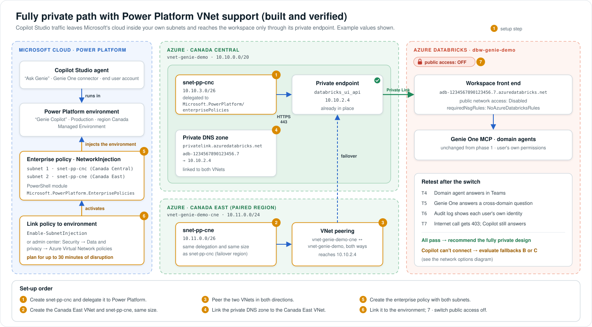

# 3. Private connectivity: Power Platform VNet support

This guide connects Microsoft's cloud to a workspace that has **public network access disabled**. Copilot Studio's
connector calls start inside **your own delegated subnets** and reach Databricks only through the workspace's
private endpoint.



> **Result in the reference build:** every Copilot call reached the workspace from the delegated subnet
> (`10.10.3.x`) while public network access was **Disabled**. Calls were verified in `system.access.audit`, see
> [06-testing-and-verification.md](06-testing-and-verification.md).

---

## 3.1 How it works

| Without VNet support | With VNet support |
|---|---|
| Connector calls leave from Microsoft's shared public IP ranges | Connector calls run in containers injected into **your** delegated subnet |
| The workspace must accept public traffic (optionally filtered by an IP access list) | The workspace keeps public access **disabled** |
| DNS resolves the workspace's public address | DNS uses your VNet's resolver, so `adb-….azuredatabricks.net` resolves to the **private endpoint** |

Power Platform VNet support uses **Azure subnet delegation**. An **enterprise policy** (an Azure resource of type
`Microsoft.PowerPlatform/enterprisePolicies`, kind `NetworkInjection`) lists the delegated subnets. Linking the policy
to an environment makes that environment's connectors run inside those subnets.

**Which connectors use it.** Microsoft lists supported services. The **Databricks** connector and **custom
connectors** are both on the generally available list. This build uses a custom connector for Genie One, see
[04-genie-one-connector-and-copilot-agent.md](04-genie-one-connector-and-copilot-agent.md).
[Virtual Network support overview](https://learn.microsoft.com/en-us/power-platform/admin/vnet-support-overview)

## 3.2 Requirements

| Requirement | Value in this build | Why |
|---|---|---|
| Environment type | **Production** (Sandbox, Default and Developer are also supported; **Trial and Dataverse for Teams are not**) | Production gets the strongest service commitments |
| Managed Environment | **Yes** | Needed for VNet support and governance features |
| Azure subscription linked to the tenant | Yes | The enterprise policy and subnets live in Azure |
| **Two delegated subnets, one per region of the Power Platform region pair** | Region *Canada* → `canadacentral` **and** `canadaeast` | Power Platform runs the environment in both regions for failover, so both need a subnet |
| Subnet delegation | `Microsoft.PowerPlatform/enterprisePolicies` | Hands the subnet to Power Platform |
| Subnet size | **/26** each (59 usable IPs) | Microsoft advises 25–30 IPs per production environment and 6–10 per non-production one; each subnet reserves 5. Both subnets must have the same number of free IPs. |
| Dedicated subnets | Yes | A delegated subnet can't host anything else and can't be shared between enterprise policies |

> **Do** size the subnets for growth from the start. **Otherwise** you must unlink the policy (an outage window) to change the range.

## 3.3 Build steps

The example values are listed below. Replace them with your own.

| Item | Example |
|---|---|
| Resource group | `rg-genie-demo` |
| Primary VNet (workspace) | `vnet-genie-demo` `10.10.0.0/20` (Canada Central) |
| Private endpoint subnet | `snet-pe` `10.10.2.0/26` → `pep-…-uiapi` **10.10.2.4**, `pep-…-webauth` **10.10.2.5** |
| Delegated subnet, primary | `snet-pp-cnc` **`10.10.3.0/26`** |
| Paired-region VNet | `vnet-genie-demo-cne` `10.11.0.0/24` (Canada East) |
| Delegated subnet, paired | `snet-pp-cne` **`10.11.0.0/26`** |
| Enterprise policy | `ep-genie-copilot-vnet`, location `canada` |
| Power Platform environment | `Genie Copilot` (Production, Managed) |

### Step 1: Register the resource provider
Azure portal → **Subscriptions** → your subscription → **Resource providers** → `Microsoft.PowerPlatform` → **Register**.
Do the same for `Microsoft.Network` if needed.
*Why:* Azure only accepts a resource type once its provider is registered. Otherwise step 5 fails with "subscription not registered".

### Step 2: Delegated subnet in the primary region
**Virtual networks** → `vnet-genie-demo` → **Subnets** → **+ Subnet**:
- Name `snet-pp-cnc`, starting address `10.10.3.0`, size **/26**
- **Subnet delegation:** `Microsoft.PowerPlatform/enterprisePolicies`
- No NAT gateway, NSG or route table. The subnet only needs to reach the private endpoint inside the VNet. Add a NAT gateway only if connectors in this environment must also reach the internet.

> **Do** check the size after saving. The portal defaults to /24. **Otherwise** the two subnets end up different sizes and the policy is rejected.

### Step 3: Paired-region VNet and subnet
Create `vnet-genie-demo-cne` in **Canada East** with address space `10.11.0.0/24`, and subnet `snet-pp-cne` `10.11.0.0/26`
with the same delegation. The address space must not overlap the primary VNet, or peering is impossible.

```powershell
$deleg = New-AzDelegation -Name 'pp-enterprisePolicies' -ServiceName 'Microsoft.PowerPlatform/enterprisePolicies'
$sub   = New-AzVirtualNetworkSubnetConfig -Name 'snet-pp-cne' -AddressPrefix '10.11.0.0/26' -Delegation $deleg
New-AzVirtualNetwork -Name 'vnet-genie-demo-cne' -ResourceGroupName 'rg-genie-demo' -Location 'canadaeast' `
  -AddressPrefix '10.11.0.0/24' -Subnet $sub
```

### Step 4: Peering and DNS for the paired region
- **Peering, both directions**, with *virtual network access* only (no forwarded traffic and no gateway transit):
  ```powershell
  $cnc = Get-AzVirtualNetwork -Name 'vnet-genie-demo' -ResourceGroupName 'rg-genie-demo'
  $cne = Get-AzVirtualNetwork -Name 'vnet-genie-demo-cne' -ResourceGroupName 'rg-genie-demo'
  Add-AzVirtualNetworkPeering -Name 'peer-cnc-to-cne' -VirtualNetwork $cnc -RemoteVirtualNetworkId $cne.Id
  Add-AzVirtualNetworkPeering -Name 'peer-cne-to-cnc' -VirtualNetwork $cne -RemoteVirtualNetworkId $cnc.Id
  ```
- **Private DNS zone link:** link `privatelink.azuredatabricks.net` to `vnet-genie-demo-cne`, with auto-registration **off**.

*Why:* during a regional failover, connectors run in the Canada East subnet. Without peering they can't reach the
private endpoint. Without the DNS link they resolve the workspace's public address, which is blocked.

### Step 5: Create the enterprise policy
The portal has no form for this resource. Use the ARM REST API, an ARM template, or the PowerShell module
`Microsoft.PowerPlatform.EnterprisePolicies` (`New-SubnetInjectionEnterprisePolicy`).

```powershell
$sub  = '<subscription-id>'; $rg = 'rg-genie-demo'
$vnet = "/subscriptions/$sub/resourceGroups/$rg/providers/Microsoft.Network/virtualNetworks"
$body = @{ location = 'canada'; kind = 'NetworkInjection'; properties = @{ networkInjection = @{ virtualNetworks = @(
  @{ id = "$vnet/vnet-genie-demo";     subnet = @{ name = 'snet-pp-cnc' } },
  @{ id = "$vnet/vnet-genie-demo-cne"; subnet = @{ name = 'snet-pp-cne' } } ) } } } | ConvertTo-Json -Depth 8
Invoke-AzRestMethod -Method PUT -Payload $body `
  -Path "/subscriptions/$sub/resourceGroups/$rg/providers/Microsoft.PowerPlatform/enterprisePolicies/ep-genie-copilot-vnet?api-version=2020-10-30-preview"
```

The response contains `properties.systemId` (`/regions/canada/providers/Microsoft.PowerPlatform/enterprisePolicies/<guid>`).
Power Platform refers to the policy by this ID.

> **Tip.** Version 0.20.x of the PowerShell module checks for **exact** versions of Az.Accounts, Az.Resources,
> Az.KeyVault and Az.Network, and prompts interactively to install them. Run it in an interactive session with those
> versions installed side by side. **Otherwise** use the REST call above, which has no dependencies.

### Step 6: Link the policy to the environment
**Option A (portal):** Power Platform admin center → **Security** → **Data and privacy** → **Azure Virtual Network
policies** → select the environment → choose `ep-genie-copilot-vnet`.

**Option B (PowerShell):** `Enable-SubnetInjection -EnvironmentId <env-id> -PolicyArmId <policy-arm-id>`.

Linking can make the environment unavailable for **up to 30 minutes**, so schedule it in a change window. When it's
done, the environment's **History** shows *New Network Injection Policy · Succeeded*, and Azure adds a **service
association link** to both subnets. That link stops anyone deleting the subnet while it's in use.

[Set up virtual network support for Power Platform](https://learn.microsoft.com/en-us/power-platform/admin/vnet-support-setup-configure)

### Step 7: Keep public network access disabled on the workspace
Azure portal → workspace → **Networking** → **Public network access: Disabled**. Keep any IP access list you
configured. It still protects the workspace if public access is ever switched on again.
[Azure Databricks Private Link](https://learn.microsoft.com/en-us/azure/databricks/security/network/classic/private-link)

## 3.4 Verify the network path from inside the delegated subnet

The `Microsoft.PowerPlatform.EnterprisePolicies` module ships diagnostics that run **inside the environment's
delegated subnet**: `Get-EnvironmentUsage`, `Test-DnsResolution`, `Test-NetworkConnectivity` and `Test-TLSHandshake`.
They call the environment's diagnostic endpoint (`https://<env-id-without-dashes, split>.environment.api.powerplatform.com/plex/...`)
with a token for `https://api.powerplatform.com/`.

| Test | Expected result |
|---|---|
| Network usage | `subnetName: snet-pp-cnc`, `subnetIpRange: 10.10.3.0/26`, a few reserved container IPs, DNS `168.63.129.16` |
| DNS resolution of `adb-1234567890123456.7.azuredatabricks.net` | CNAME `…privatelink.azuredatabricks.net` → **10.10.2.4** |
| TCP 443 to the workspace | `tcpSuccess: true` from a container IP such as `10.10.3.6` |
| TLS handshake | TLS 1.3, certificate `*.azuredatabricks.net`, no SSL errors |

> **Do** retry when the first diagnostic calls return **HTTP 503**. They return 503 for about a minute while a
> container starts. **Otherwise** you may wrongly conclude the network is broken. The same cold start can make the
> first connector test fail with *BadGateway*.

> **Do** force TLS 1.2 in Windows PowerShell 5.1 (`[Net.ServicePointManager]::SecurityProtocol = 'Tls12'`) before
> calling these endpoints. **Otherwise** the calls fail without a useful message.

## 3.5 What changes in Azure, and what to protect

| Resource | Change |
|---|---|
| `snet-pp-cnc`, `snet-pp-cne` | Delegated; service association link added by Power Platform |
| `vnet-genie-demo-cne` | New VNet and subnet |
| Peerings `peer-cnc-to-cne` / `peer-cne-to-cnc` | Connected |
| `privatelink.azuredatabricks.net` | New virtual network link to the paired VNet |
| `ep-genie-copilot-vnet` | New enterprise policy (a hidden resource type: tick **Show hidden types** in the classic resource list, or query it with Resource Graph) |

Protect these with **CanNotDelete** resource locks, see [05-production-hardening.md](05-production-hardening.md).

```kusto
// Azure Resource Graph: confirm the policy and its subnets
resources
| where type =~ 'microsoft.powerplatform/enterprisepolicies'
| project name, kind, location, resourceGroup, properties.networkInjection.virtualNetworks
```
