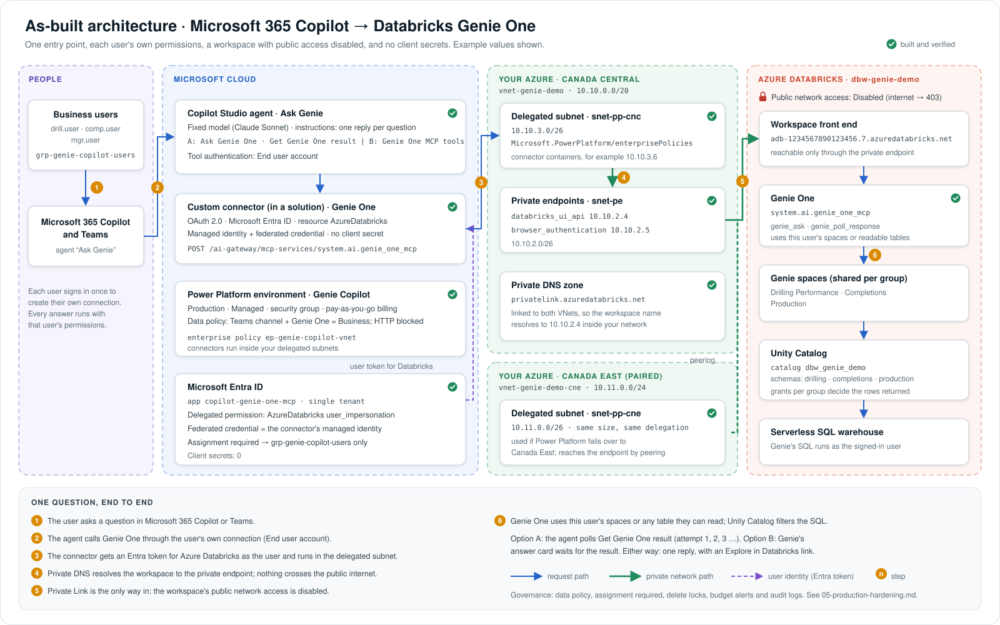
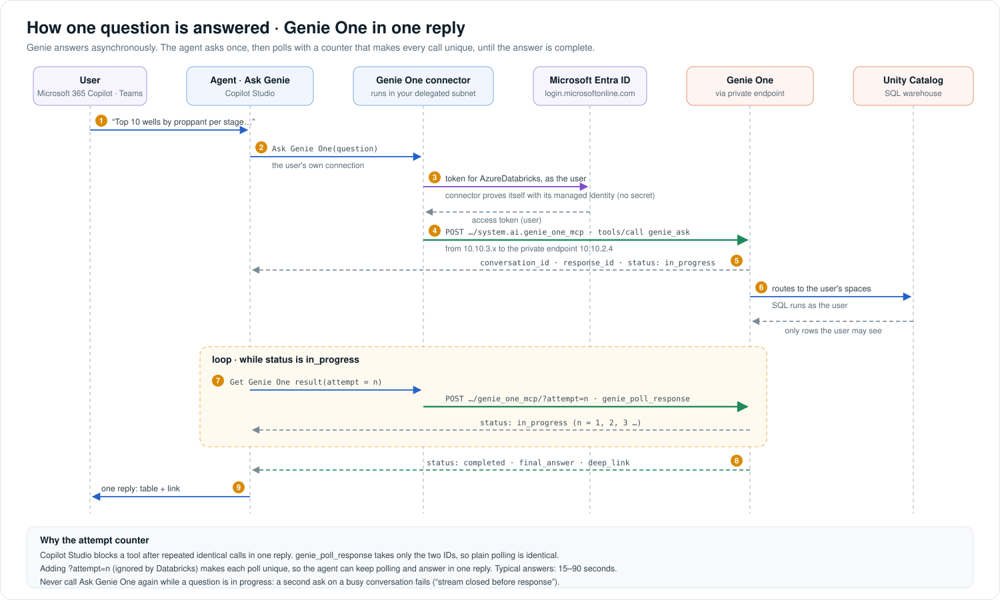

# 4. Genie One connector and the Copilot Studio agent

This guide builds the part users actually talk to: an agent in Microsoft 365 Copilot and Teams that answers every
question from **Databricks Genie One**, **as the signed-in user**, in **one reply**, with **no client secret** to
manage.

| You build | Purpose |
|---|---|
| **Entra app registration** `copilot-genie-one-mcp` | The identity users sign in through. It may only request Azure Databricks on the user's behalf. |
| **Power Platform solution** `Genie Copilot` | Holds the custom connector (and optionally the agent), so it is solution-aware and can move between environments |
| **Custom connector**, option A *or* B (4.1) | Calls the Genie One MCP endpoint as the user. Uses a **managed identity** with a **federated credential** instead of a secret. |
| **Dataverse group team + connector sharing** | Lets the users' security group create their own connections to the custom connector |
| **Copilot Studio agent** `Ask Genie` | Calls Genie One and presents the answer in Microsoft 365 Copilot and Teams |

Prerequisites: [02-prerequisites-licensing-and-billing.md](02-prerequisites-licensing-and-billing.md) (including the
Power Platform environment, 2.6) and the private network from
[03-private-connectivity-power-platform-vnet.md](03-private-connectivity-power-platform-vnet.md).
Design choices and alternatives are explained in [07-design-decisions.md](07-design-decisions.md).

### Configuration reference (example values)

Every value below is an example. Replace it with your own; keep the same value wherever it appears.

| Item | Example value | Used in |
|---|---|---|
| Tenant | `contoso.onmicrosoft.com`, tenant ID `<tenant-id>` | 4.3, 4.5 |
| Workspace host | `adb-1234567890123456.7.azuredatabricks.net` | 4.5, data policy (05) |
| Genie One MCP path | `/ai-gateway/mcp-services/system.ai.genie_one_mcp` | 4.5 |
| AzureDatabricks application (same in every tenant) | `2ff814a6-3304-4ab8-85cb-cd0e6f879c1d` | 4.3, 4.5 |
| Power Platform environment | `Genie Copilot` (Production, Managed) | all steps |
| Solution | Display name `Genie Copilot`, name `GenieCopilot`, publisher of your choice (example prefix `contoso`) | 4.4 |
| Entra app registration | `copilot-genie-one-mcp` (single tenant) | 4.3, 4.6 |
| Connector, option A | `Genie One` · file [connector/genie-one-connector.swagger.yaml](../connector/genie-one-connector.swagger.yaml) | 4.5 |
| Connector, option B | `Genie One MCP` · file [connector/genie-one-mcp-connector.swagger.yaml](../connector/genie-one-mcp-connector.swagger.yaml) | 4.5 |
| Federated credential names | `pp-connector-genie-one` (A) · `pp-connector-genie-one-mcp` (B) | 4.6 |
| Users' security group (and Dataverse group team) | `grp-genie-copilot-users` | 4.8, 4.10, 05 |
| Data access groups | `grp-genie-drilling`, `grp-genie-completions`, `grp-genie-managers` | guide 01 |
| Agent | `Ask Genie` | 4.9 |
| Agent instructions | A: [ask-genie-agent-instructions.md](../connector/ask-genie-agent-instructions.md) · B: [ask-genie-agent-instructions-mcp.md](../connector/ask-genie-agent-instructions-mcp.md) | 4.9 |
| Model | A fixed model, for example Claude Sonnet 5.5 | 4.9 |

---

## 4.1 Choose the connector option

Both options call the same Genie One MCP endpoint, use the same Entra app, the same private network path and the
same per-user sign-in. They differ in **how Copilot Studio talks to Genie One**. You can build both in the same
environment: each connector gets its own redirect URI and federated credential on the one Entra app (4.6).

| | **Option A: two REST actions** | **Option B: MCP server** |
|---|---|---|
| How it works | The connector defines two actions, *Ask Genie One* and *Get Genie One result*. The agent asks once, then polls with an increasing `attempt` counter until the answer is complete. | The connector is marked as an MCP server. Copilot Studio discovers Genie One's tools from the server. The agent calls *View ask* once; Genie's interactive answer card waits for the result inside the chat. |
| Connector definition | About 200 lines (actions, request and response schemas) that you maintain | About 30 fixed lines; never changes |
| New Genie One features | Edit the definition | Appear automatically; you enable them per tool (*Allow all* off) |
| New Genie spaces (and new grants) | No change needed: reachable at once | No change needed: reachable at once |
| Agent polling | 8–15 tool calls per question | None by the agent (the answer card polls) |
| Answer in Microsoft 365 Copilot | Text and tables written by the agent from Genie's answer | Genie's own answer card (table, steps, sources, *Explore in Genie*) plus one short agent sentence |
| Answer in Teams | Text and tables | A short holding message, then the answer as text (Teams doesn't display MCP app cards) |
| Follow-up questions | Agent asks Genie again in the same conversation | Answered from the card's result where possible; asks Genie again only for new analysis |
| Copilot Credits per question (measured, cross-domain question, Copilot Studio test pane) | About 36 | About 6 |
| Preview dependencies | None (connector actions are generally available) | MCP tools in Copilot Studio's agent experience are **Preview**; record an accepted preview exception (guide 10) |
| Behaviour control | Fully defined by you: actions and instructions | Partly defined by Databricks: tool descriptions can change when the server is updated. Keep *Allow all* off and re-test after Databricks releases. |
| Solution | Recommended | **Required**: create the connector inside a solution, or Copilot Studio can't save the MCP tool |
| Best for | Organisations that accept no preview features, or need full control of the answer format | Lower cost, less maintenance and Genie's richer answer, where the MCP preview is acceptable |

> **Do** choose one option per agent. **Otherwise** the agent has two ways to ask the same question and its behaviour
> becomes unpredictable.

> **Be aware** that both options connect Copilot to **Genie One**, which can answer from **every table the user can
> read**, including tables in no Genie space. Use them only when your Unity Catalog grants are least-privilege and
> every readable table is acceptable to surface in Copilot. Otherwise connect individual Genie spaces as tools
> instead ([07 D2](07-design-decisions.md#d2-entry-point-genie-one-vs-one-tool-per-genie-space)).

## 4.2 How one question flows

Common to both options:

1. The user asks in Teams or Microsoft 365 Copilot.
2. Copilot Studio calls the connector through the **user's own connection**.
3. The connector gets an **Entra ID access token for Azure Databricks on behalf of the user**. It proves its own
   identity with its managed identity's federated credential, not a secret.
4. The call runs from a container in the **delegated subnet** and reaches the workspace's **private endpoint**.
5. Genie One routes the question to the Genie spaces **this user** can use, or queries any table the user can read
   directly, and runs SQL **as this user**. Unity Catalog returns only the rows the user may see.

Then:

| Option A (diagram above) | Option B ([diagram 13](diagrams.md#13-connector-options)) |
|---|---|
| 6. Genie One returns `conversation_id`, `response_id` and `status: in_progress`. | 6. The agent calls **View ask** once. Genie One returns the IDs and an interactive answer card. |
| 7. The agent calls **Get Genie One result** with `attempt = 1, 2, 3 …` until `status: completed`, then writes the answer. | 7. The card polls Genie One through the same connector, shows progress, then the answer. The final answer is added to the agent's context for follow-ups. |

## 4.3 Register the Entra app (identity for sign-in)

**Role:** Cloud Application Administrator or Application Administrator. Admin consent may need a higher role,
depending on your consent policy.

1. **Entra admin center** → **Identity** → **Applications** → **App registrations** → **+ New registration**:

   | Field | Value |
   |---|---|
   | Name | `copilot-genie-one-mcp` |
   | Supported account types | **Accounts in this organizational directory only (single tenant)** |
   | Redirect URI | leave empty; each connector generates its own in 4.5 |

2. Note the **Application (client) ID** and the **Directory (tenant) ID**.
3. **API permissions** → **+ Add a permission** → **APIs my organization uses** → **AzureDatabricks**
   (`2ff814a6-3304-4ab8-85cb-cd0e6f879c1d`) → **Delegated** → `user_impersonation` → **Add**. Keep the default
   Microsoft Graph `User.Read`.
4. **Grant admin consent for <tenant>**. Every row then shows *Granted*, so users aren't asked to consent one by one.
5. **Don't create a client secret.** Each connector authenticates with a federated credential (4.6).
6. **Enterprise applications** → `copilot-genie-one-mcp` → **Properties** → **Assignment required: Yes**, **Visible
   to users: No** → **Users and groups** → add `grp-genie-copilot-users` (see [05](05-production-hardening.md)).

*Why delegated `user_impersonation`:* the token says "this user, through this app". Databricks then evaluates
Unity Catalog for that user. An application permission or service principal would make every user share one identity.
[Register an application](https://learn.microsoft.com/en-us/entra/identity-platform/quickstart-register-app)

## 4.4 Create a solution

**Role:** Environment Maker (System Customizer to create a publisher).

`https://make.powerapps.com` → environment **Genie Copilot** → **Solutions** → **+ New solution**:

| Field | Value |
|---|---|
| Display name | `Genie Copilot` |
| Name | `GenieCopilot` |
| Publisher | your organisation's publisher (create one with prefix, for example `contoso`), or the environment's default publisher |
| Version | `1.0.0.0` |

*Why:* a connector created inside a solution is a Dataverse record (*solution-aware*). Copilot Studio requires this
for MCP tools (option B), and a solution lets you move the connector and agent from development to production
(guide 07, D10).

> **Do** create the connector from **inside** the solution (4.5). **Otherwise** it is stored outside Dataverse, and
> converting it later (*Add existing → Outside Dataverse*) can fail; deleting and recreating it inside the solution
> is then the reliable fix.

## 4.5 Create the custom connector

**Role:** Environment Maker in the target environment. Create the connector **in the same environment as the agent**.
A connector in another environment neither appears in the agent nor uses that environment's VNet policy.

1. **Solutions** → `Genie Copilot` → **+ New** → **Automation** → **Custom connector**.
2. **Connector name** (top of the page): `Genie One` for option A, or `Genie One MCP` for option B.
3. **General** tab:

   | Field | Value |
   |---|---|
   | Scheme | **HTTPS** |
   | Host | `adb-1234567890123456.7.azuredatabricks.net` |
   | Base URL | `/ai-gateway/mcp-services` |
   | Connect via on-premises data gateway | **unticked** (the VNet policy provides the private route) |

4. **Security** tab (identical for both options):

   | Field | Value | Why |
   |---|---|---|
   | Authentication type | **OAuth 2.0** | Users sign in interactively |
   | Identity provider | **Azure Active Directory** (Microsoft Entra ID) | Tokens come from `login.microsoftonline.com`, which is always reachable. The workspace's own OAuth endpoints sit behind the disabled public access. |
   | Client ID | the app's client ID from 4.3 | |
   | Secret options | **Use managed identity** | No secret to store, rotate or leak |
   | Authorization URL | `https://login.microsoftonline.com` | |
   | Tenant ID | your tenant **GUID** (not `common`) | Managed identity requires a single-tenant app and a real tenant ID |
   | Resource URL | `2ff814a6-3304-4ab8-85cb-cd0e6f879c1d` | The AzureDatabricks application |
   | Enable on-behalf-of login | `false` | Not needed |
   | Scope | empty | |

5. **Definition** tab → turn on **Swagger editor** → replace the content with the file for your option, after
   replacing the `host` with your workspace host:

   | Option | File | What the Definition tab then shows |
   |---|---|---|
   | A | [connector/genie-one-connector.swagger.yaml](../connector/genie-one-connector.swagger.yaml) | Two actions, **AskGenieOne** and **GetGenieOneResult**. Fields marked `internal` (`jsonrpc`, `id`, `method`, `params.name`) are filled automatically and hidden from the agent. |
   | B | [connector/genie-one-mcp-connector.swagger.yaml](../connector/genie-one-mcp-connector.swagger.yaml) | One operation, **InvokeGenieOneMCP**, with `x-ms-agentic-protocol: mcp-streamable-1.0`. Its visibility can stay *none*. |

6. **Create connector**. Then open the **Security** tab again and copy two generated values:
   - **Redirect URL:** `https://global.consent.azure-apim.net/redirect/<connector-id>`
   - **Managed identity:** *Issuer* `https://login.microsoftonline.com/<tenant-id>/v2.0`, *Subject*
     `/eid1/c/pub/t/<…>/a/<…>/<geo>_<connector-id>`, *Audience* `api://AzureADTokenExchange`

   The `<connector-id>` includes the solution publisher's prefix, for example `contoso-5fgenie-20one-20mcp-…`.

[Authenticate your API and connector with Microsoft Entra ID (managed identity)](https://learn.microsoft.com/en-us/connectors/custom-connectors/azure-active-directory-authentication) ·
[Create a custom connector from an OpenAPI definition](https://learn.microsoft.com/en-us/connectors/custom-connectors/define-openapi-definition) ·
[Add tools from an MCP server to your agent](https://learn.microsoft.com/en-us/microsoft-copilot-studio/mcp-add-components-to-agent)

## 4.6 Trust the connector in the Entra app

In **App registrations** → `copilot-genie-one-mcp`, for **each** connector you created:

1. **Authentication** → **Add a platform / Add Redirect URI** → **Web** → paste the connector's **Redirect URL** →
   **Save**. Leave implicit grant **off**.
2. **Certificates & secrets** → **Federated credentials** → **+ Add credential** → scenario **Other issuer**:

   | Field | Value |
   |---|---|
   | Issuer | copied from the connector, for example `https://login.microsoftonline.com/<tenant-id>/v2.0` |
   | Type | **Explicit subject identifier** |
   | Value | the connector's managed identity **Subject**, copied exactly |
   | Name | `pp-connector-genie-one` (option A) or `pp-connector-genie-one-mcp` (option B) |
   | Audience | `api://AzureADTokenExchange` |

With both options, the app has two redirect URIs and two federated credentials, and still **no secret**.

> **Do** copy the issuer and subject character for character. **Otherwise** sign-in fails with *AADSTS70021 / 700213
> no matching federated identity record*.
> **Do** add a new redirect URI and federated credential whenever you recreate a connector or import it into another
> environment. It gets a new managed identity there.

[Workload identity federation](https://learn.microsoft.com/en-us/entra/workload-id/workload-identity-federation)

## 4.7 Test the connector

**Test** tab → **+ New connection** → sign in as yourself → status **Connected**.

- **Option A:** run **AskGenieOne** with the question `Which rig has the lowest average drilling days?`.
  **Expected:** `200` with `"status":"in_progress"`, a `conversation_id` and a `response_id`. Then run
  **GetGenieOneResult** with those IDs and `attempt` = 1, 2, 3 … until `"status":"completed"` and `final_answer`
  contains the result.
- **Option B:** the connection is enough. MCP operations are tested through the agent (4.9).

## 4.8 Share the connector with the users' group

A custom connector is private to its creator. Users can't create a connection to it until it is shared. Until then
they see *"Connector information unavailable"*, and the connector appears under its internal name `shared_…`.

1. **Create a Dataverse group team** for the security group (once per environment). Sharing a connector with an
   Entra group needs a matching team. **Otherwise** sharing fails with *"The AAD group … does not exist in
   Dataverse"*.
   - Power Platform admin center → **Environments** → `Genie Copilot` → **Settings** → **Users + permissions** →
     **Teams** → **+ Create team**:

     | Field | Value |
     |---|---|
     | Team name | `grp-genie-copilot-users` |
     | Business unit | the environment's root business unit |
     | Team type | **Microsoft Entra ID Security Group** |
     | Group name | `grp-genie-copilot-users` |
     | Membership type | **Members and guests** |
     | Security role | **Basic User** |

   - Members are added just in time when they sign in.
   [Manage group teams](https://learn.microsoft.com/en-us/power-platform/admin/manage-group-teams)
2. Power Apps → **Custom connectors** (or the solution) → your connector → **Share** → add
   `grp-genie-copilot-users` with **Can view**. This is the "can use" level: users create their own connection but
   can't change the connector. Repeat for each connector you created.
   [Share a custom connector](https://learn.microsoft.com/en-us/connectors/custom-connectors/share)

*For automation:* a solution connector is a Dataverse `connector` record, so it can also be shared with the Dataverse
`GrantAccess` action (team principal, `ReadAccess, AppendAccess, AppendToAccess`). The Power Apps connector
permissions API doesn't manage solution connectors.

## 4.9 Build the Copilot Studio agent

**Role:** Environment Maker with a Copilot Studio maker licence (a trial can build and test but can't publish).

1. `https://copilotstudio.microsoft.com` → environment **Genie Copilot** → **Agents** → **+ New agent** → **Configure**:

   | Setting | Value |
   |---|---|
   | Name | `Ask Genie` |
   | Description | `Answers questions about the organisation's data from Databricks Genie One, using each user's own data permissions.` |
   | Instructions | Option A: [ask-genie-agent-instructions.md](../connector/ask-genie-agent-instructions.md) · Option B: [ask-genie-agent-instructions-mcp.md](../connector/ask-genie-agent-instructions-mcp.md) (paste the text block) |
   | Model | a specific model, not *Auto*. Databricks recommends a Claude Sonnet model; the reference build uses Claude Sonnet 5.5. Anthropic models must be allowed by a tenant admin (see 2.5). |
   | Knowledge | none. Remove **Search all websites** if present. |
   | Default tools | remove **Work IQ** (Microsoft 365 data) if present, so answers come only from Genie |
   | Memory (preview) | Off |

2. **Tools** for your option:

   **Option A:**
   - **Tools → +** → search `Genie One` → **Ask Genie One** → connection: your connection · **Authentication: End
     user account** · inputs *Question* and *Conversation ID*: **Fill with AI** → **Add**.
   - Add **Get Genie One result** the same way (*Attempt*, *Conversation ID*, *Response ID*: **Fill with AI**).

   **Option B:**
   - **Tools → +** → search `Genie One MCP` (listed as an MCP server) → your connection → **Add and configure** →
     **Authentication: End user account**.
   - **Allow all: Off**, then enable only the tools below → **Done**.

     | Tool | Setting |
     |---|---|
     | View ask | **On** |
     | Genie ask | **On** |
     | Genie poll response | **On** |
     | Genie get query result · Genie cancel response | Off |
     | View poll response · View fetch query results | Off |
     | View respond approval | **Off** |

   With *Allow all* off, tools that Databricks adds later stay off until you review them. New Genie spaces need no
   change: Genie One reaches every space through the same tools. Reasons per tool are in
   [ask-genie-agent-instructions-mcp.md](../connector/ask-genie-agent-instructions-mcp.md).

3. **Settings → Greeting & prompts** (optional): conversation starters, for example *Which rig has the lowest average
   drilling days?*, *Top 10 wells by proppant per stage and their first-3-month oil*, *What data can I ask you about?*
4. **Save**, then test in **Preview** → **+ New chat** with the questions in 4.12.

> **Do** start a **New chat** after changing tools or instructions. A browser refresh isn't enough.
> **Otherwise** the old session keeps its old tool list, and the agent says no Genie tools are available.

> **Do** reload the Copilot Studio page if a tool call fails with *"Error from token exchange: Bad authorization
> token"*. **Otherwise** a stale maker session token keeps failing even though the connection is healthy.

[Use Azure Databricks data in Copilot Studio](https://learn.microsoft.com/en-us/azure/databricks/integrations/msft-power-platform/copilot-studio) ·
[Use MCP apps in Copilot Studio](https://learn.microsoft.com/en-us/microsoft-copilot-studio/agents-experience/mcp-apps) ·
[Configure user authentication](https://learn.microsoft.com/en-us/microsoft-copilot-studio/configuration-end-user-authentication)

## 4.10 Share and publish the agent

The standard procedure uses only the agent's **Share** setting and a link. Nothing else needs to be configured.

1. **Settings → Security → Authentication:** **Authenticate with Microsoft** (the default for new agents).
2. **Share** → add `grp-genie-copilot-users` with **Can use** → **untick the email invitation** → **Org-wide sharing
   for use access: Off** → **Share**. Only members of the group can chat with the agent.
3. **Channels → +** → **Teams + Microsoft 365** → **Availability:** *Microsoft Copilot and Microsoft Teams* (this
   can't be changed after publishing) → **Add**.
4. **Publish.** If the only warning is *No evaluation run*, publishing is still allowed.
5. **Share** → **Copy sharing link** → choose the Microsoft 365 Copilot or Teams link. Send the link and the agent
   name (`Ask Genie`) to the users' group, with the onboarding steps in 4.11.

**Updating the agent later:** changes to instructions, tools or model go live for every user when you **Publish**.

### Optional: org catalogue and pre-installation
Use this **instead of** sharing links if you want the agent listed under **Built for your org** and installed
automatically for the group. Don't combine it with links. **Otherwise** users who used a link get a second copy of
the agent.

1. Copilot Studio → **Channels → Teams + Microsoft 365 → Use and share → Submit to org catalog**. The button shows
   the current status, for example *Approved — v1.0.1*; submit again after changing the name, icon, description,
   greeting or conversation starters. (Older Copilot Studio versions: *Availability options → Show to everyone in my
   org → Submit for admin approval*.)
2. Microsoft 365 admin center (AI or Global Administrator) → **Agents → All agents → Requests** → the agent →
   **Publish**: **Available to** `grp-genie-copilot-users`, **Installed for** `grp-genie-copilot-users`.
3. If a user ends up with two copies, remove the link-based copy in **Teams → Apps → Manage your apps**.

### Optional: pin the agent in Teams
Installation doesn't pin the agent on the Teams left bar. To pin it:

1. **Teams admin center → Teams apps → Setup policies → + Add**: name `Genie Copilot users`; keep **Upload custom
   apps** Off and **User pinning** On.
2. **Pinned apps → + Add apps** → `Ask Genie` → **Add**; move it up with **Move up**. Keep the apps pinned in the
   Global policy, because this policy replaces Global for its users.
3. **Save** → **Group policy assignment** → **+ Add**: group `grp-genie-copilot-users`, rank `1`, policy
   `Genie Copilot users` → **Apply**. Changes take a few hours. Users' own pins stay below the admin-pinned apps.

[Connect and configure an agent for Teams and Microsoft 365 Copilot](https://learn.microsoft.com/en-us/microsoft-copilot-studio/publication-add-bot-to-microsoft-teams) ·
[Share agents with other users](https://learn.microsoft.com/en-us/microsoft-copilot-studio/admin-share-bots) ·
[Manage agents in the Microsoft 365 admin center](https://learn.microsoft.com/en-us/microsoft-365/admin/manage/manage-copilot-agents-integrated-apps) ·
[Manage app setup policies in Teams](https://learn.microsoft.com/en-us/microsoftteams/teams-app-setup-policies)

### What each kind of user experiences

Four independent layers protect the data, so a gap in one is caught by the next:

| Layer | Not in `grp-genie-copilot-users` | In `grp-genie-copilot-users`, no data group | In both groups |
|---|---|---|---|
| 1. **Chat** (agent share) | *"You don't have access to talk to this bot"*, even with the link | Can chat | Can chat |
| 2. **Connect** (connector shared with the group; Entra app *Assignment required*) | Can't create the connection: *Connector information unavailable* or *AADSTS50105* | Creates their own connection once | Same |
| 3. **Data** (Unity Catalog grants; Genie One isn't limited by space sharing) | No data | *"This data isn't available with your current access."* | Answers with exactly the data their groups allow |
| 4. **Discovery** (optional org catalogue) | Doesn't see it in the store | Sees it, pre-installed | Same |

Removing a user from `grp-genie-copilot-users` closes chat and connector sign-in at once. Removing them from a data
group only narrows what Genie returns.

## 4.11 Onboard each user

1. Open the agent link and select **Add** (Microsoft 365 Copilot) or **Open** (Teams).
2. Ask a first question. The agent shows a **Connect** card for the connector (`Genie One` or `Genie One MCP`):
   **Connect** → sign in as yourself → **Continue**. Alternatively, create the connection beforehand from the agent's
   **user connection setup link** (Copilot Studio → agent → channel settings).
3. Ask again. Answers now arrive as the user.

> **Do** create the connection before the user's first chat in **Teams**, for example by asking the first question
> in Microsoft 365 Copilot. **Otherwise** a Teams conversation opened before the connection existed can stay bound
> to the missing connection and keep failing. Microsoft 365 Copilot isn't affected.

> **Do** ask users to revisit the setup link after you replace or rename tools. Old bindings show as **Stale**:
> choose **Review** → pick the existing connection → **Submit**.

## 4.12 Expected results

| User (groups) | "Which rig has the lowest average drilling days?" | "Top 10 wells by proppant per stage and their first-3-month oil" |
|---|---|---|
| drill.user (drilling) | ✅ Rig 12, 17.52 days | ❌ No completions or production data visible, so no numbers |
| comp.user (completions) | ❌ No access to the drilling schema | ⚠️ Proppant ranking only; oil not available |
| mgr.user (managers) | ✅ Rig 12, 17.52 days | ✅ Full table: W-0166 top, 39,653 bbl in total |

Each answer arrives in **one reply**. With option B in Microsoft 365 Copilot, the answer appears as Genie's card; a
follow-up such as *"Which of those wells produced the most oil?"* returns W-0131, 4,657 bbl without a new Genie call.
Verification queries are in [06-testing-and-verification.md](06-testing-and-verification.md).
