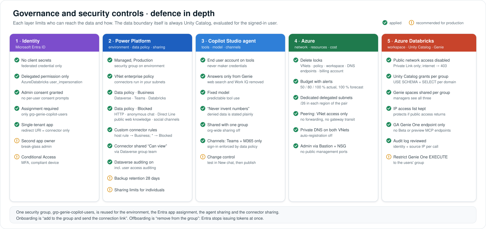

# 5. Production hardening

The controls below make the working solution safe to run in production. Each one states **what** it does, **why**,
and **how** it was applied in the reference build. Items marked *recommended* weren't applied in the reference build but should be
decided for production.



---

## 5.1 Identity (Microsoft Entra ID)

| Control | Setting | Why | Status |
|---|---|---|---|
| **No client secrets** | App registration has **0 client secrets** and **1 federated credential** (the connector's managed identity) | Nothing to rotate, leak or expire | ✅ Applied |
| **Assignment required** | Enterprise application `copilot-genie-one-mcp` → Properties → **Assignment required = Yes**, assigned to `grp-genie-copilot-users` | Only intended users can get a Databricks token through this app. Everyone else is refused at sign-in (*AADSTS50105*), before Databricks is contacted. | ✅ Applied |
| **Visible to users = No** | Same page | Users reach the agent through Copilot, not the My Apps portal | ✅ Applied |
| **Delegated permission only** | AzureDatabricks `user_impersonation` (delegated), admin consent granted | Every call carries the user's identity | ✅ Applied |
| **Second owner** | App registration → Owners | Avoids one person being the only one who can manage the app | *Recommended* |
| **Conditional Access** | Require MFA and compliant devices for the users' group | Protects the sign-in that unlocks the data | *Recommended (tenant policy)* |

[Manage users and groups assignment to an application](https://learn.microsoft.com/en-us/entra/identity/enterprise-apps/assign-user-or-group-access-portal)

## 5.2 Power Platform

| Control | Setting | Why | Status |
|---|---|---|---|
| **Managed Environment** | Environment `Genie Copilot`, Production, Managed | Required for VNet support; unlocks governance features | ✅ Applied |
| **Environment security group** | `grp-genie-copilot-users` | Only members can access the environment | ✅ Applied |
| **Data policy (DLP)** `dp-genie-copilot-prod`, scoped to this environment only | **Business:** Microsoft Dataverse, Azure Databricks, *Microsoft Teams + M365 Channel in Copilot Studio*. **Blocked:** HTTP, HTTP with Microsoft Entra ID, HTTP Webhook, *Chat without Microsoft Entra ID authentication in Copilot Studio*, Direct Line, Facebook, Omnichannel, WhatsApp, *Knowledge source with public websites and data*. | Agents can only use reviewed connectors. Every chat must be authenticated, so the per-user model holds. No public web knowledge, no anonymous channels. | ✅ Applied |
| **Custom connector rules** in the same policy | `[1] https://adb-1234567890123456.7.azuredatabricks.net*` → **Business**, `[2] *` → **Blocked** | Only custom connectors that point to your workspace are allowed. Classifying Genie One as Business lets it sit alongside the Business Teams channel. | ✅ Applied (via admin API) |
| **Default group for new connectors** | Non-business | Business and Non-business connectors can't be combined, so any Non-business connector is unusable in this agent. Setting the default to *Blocked* was refused because some Microsoft connectors can't be blocked. | ✅ Reviewed |
| **Agent sharing** | Shared with `grp-genie-copilot-users` only (**Can use**, no email invitation); org-wide sharing **off**. Check it: the agent's Dataverse `bot.accesscontrolpolicy` should be *group membership*, not *any*. | Least privilege: only the group can chat | ✅ Applied |
| **Agent distribution** | One method only: the agent's sharing link sent to the group (standard), **or** the org catalogue with admin approval and pre-installation (optional). Never both. | Avoids duplicate copies of the agent; only the group can chat with it either way | ✅ Applied (sharing link) |
| **MCP tool permissions** (connector option B) | Tool → **Allow all: Off**; only *View ask*, *Genie ask* and *Genie poll response* on; *View respond approval* off | Least privilege; tools Databricks adds later stay off until reviewed | ✅ Applied |
| **Connector in a solution** | Custom connectors created inside the `Genie Copilot` solution | Required for option B; enables moving connector and agent between environments | ✅ Applied |
| **Teams pinning** | Optional Teams app setup policy assigned to `grp-genie-copilot-users` | Only if users should find the agent on the Teams left bar | *Optional* |
| **Connector sharing** | Custom connector shared with the group as **Can view** through a Dataverse group team | Users can connect but can't edit the connector | ✅ Applied |
| **Dataverse auditing** | Auditing and user-access auditing on | Records changes to agents, connections and settings | ✅ On (production default) |
| **Sharing limits** (Managed Environment) | Don't use *Exclude sharing with security groups*, because the agent is shared with a group. Optionally cap the number of individual users. | Prevents oversharing to individuals | *Recommended* |
| **Backup retention** | 28 days for production | Longer point-in-time restore for the environment | *Recommended* |

> **Do** add the custom connector URL rule whenever you create a data policy for this environment. **Otherwise** the
> Genie One connector falls into the default (Non-business) group, the agent mixes Business and Non-business
> connectors, and the policy blocks it.

[Data policies](https://learn.microsoft.com/en-us/power-platform/admin/wp-data-loss-prevention) ·
[Configure data policies for agents](https://learn.microsoft.com/en-us/microsoft-copilot-studio/admin-data-loss-prevention) ·
[Custom connector URL patterns](https://learn.microsoft.com/en-us/power-platform/admin/dlp-custom-connector-parity) ·
[Manage Dataverse auditing](https://learn.microsoft.com/en-us/power-platform/admin/manage-dataverse-auditing) ·
[Limit sharing](https://learn.microsoft.com/en-us/power-platform/admin/managed-environment-sharing-limits) ·
[Back up and restore environments](https://learn.microsoft.com/en-us/power-platform/admin/backup-restore-environments)

### Apply the custom connector rules with the API (optional)
The admin center can do this. For automation, the endpoint used by the `Microsoft.PowerApps.Administration.PowerShell`
module is shown below. It takes a token for `https://service.powerapps.com/`.

```powershell
$tenant = '<tenant-id>'; $policy = '<data-policy-id>'
$rules = @{ rules = @(
  @{ order = 1; customConnectorRuleClassification = 'Confidential'; pattern = 'https://adb-1234567890123456.7.azuredatabricks.net*' },  # Business
  @{ order = 2; customConnectorRuleClassification = 'Blocked';      pattern = '*' } ) } | ConvertTo-Json -Depth 4
Invoke-RestMethod -Method POST -Headers @{ Authorization = "Bearer $token" } -ContentType 'application/json' -Body $rules `
  -Uri "https://api.bap.microsoft.com/providers/PowerPlatform.Governance/v1/tenants/$tenant/policies/$policy/urlPatterns?api-version=2016-11-01"
```

## 5.3 Azure

| Control | Setting | Why | Status |
|---|---|---|---|
| **Delete locks** (`CanNotDelete`) | Both VNets, the enterprise policy, the Databricks workspace, the private DNS zone, both private endpoints, the pay-as-you-go billing account | Nobody can accidentally delete part of the private path. Changes are still allowed. | ✅ Applied |
| **Budget** | Resource-group budget with alerts at 50 %, 80 % and 100 % actual and 100 % forecast | Pay-as-you-go Copilot Studio credits and networking are billed to this resource group | ✅ Applied |
| **No public IP on Databricks compute; public access disabled** | Workspace networking | The workspace accepts traffic only through its private endpoint | ✅ Applied |
| **Admin access** | Jumpbox reached through Azure Bastion (Developer SKU), with an NSG allowing RDP only from approved IPs | No public management exposure | ✅ Applied |

> **Be aware** that a delete lock on a VNet also blocks deleting its subnets, and unlinking the enterprise policy
> removes the subnets' service association link. Remove the lock under change control first.

[Lock your Azure resources](https://learn.microsoft.com/en-us/azure/azure-resource-manager/management/lock-resources) ·
[Create and manage budgets](https://learn.microsoft.com/en-us/azure/cost-management-billing/costs/tutorial-acm-create-budgets)

## 5.4 Azure Databricks

| Control | Setting | Why | Status |
|---|---|---|---|
| Unity Catalog least privilege | One schema per domain; `USE SCHEMA` + `SELECT` only to that domain's group and managers | The data boundary that every Copilot answer respects | ✅ Applied |
| Genie spaces shared per group | Drilling: drilling + managers · Completions: completions + managers · Production: managers | Users only see spaces relevant to them. Sharing doesn't limit what Genie One can read. | ✅ Applied |
| Grants no wider than the curated spaces | Every table a group can read is in one of that group's spaces. Review catalog-level grants, *All account users* / *users* grants and the auto-created `_workspace_users_…` group. | Genie One, and so the Copilot agent, can answer from **any** table the user can read, curated or not ([07 D2](07-design-decisions.md#d2-entry-point-genie-one-vs-one-tool-per-genie-space)) | ✅ Applied |
| Views owned by a privileged identity granted deliberately | `completions.well_header` exposes only `well_id`, `play`, `rig` | A view reads with its owner's rights, so granting it exposes the underlying data | ✅ Applied |
| Row filters and column masks | For sensitive rows and columns | Fine-grained protection that applies everywhere, Genie included | *Recommended where data is sensitive* |
| Periodic access tests per persona | Allowed, blocked and no-data questions per persona, including a readable table that's in no space ([06 §6.5](06-testing-and-verification.md#65-genie-one-vs-space-scope)) | Detects regressions after grant or platform changes | *Recommended* |
| Instructions aren't access control | Genie One and space instructions used for terminology and "not available" wording only; free of sensitive details | An "agents only" instruction isn't enforced; anyone who can use a space can read its instructions | ✅ Applied |
| IP access list kept enabled | Allow list stays configured even with public access off | Protects the workspace if public access is ever switched on | ✅ Applied |
| Audit log | `system.access.audit` (Public Preview) reviewed for identity and source IP | Proves who asked and from where | ✅ Used for verification |
| Diagnostic log delivery | Workspace diagnostic settings to Log Analytics or storage | Compliance-grade audit retention that doesn't depend on a preview table | *Recommended* |
| Managed MCP Servers preview | **Off.** Both connector options use only the GA Genie One MCP server, which doesn't need this preview. | No preview dependency in production ([guide 10](10-preview-features-and-production-readiness.md)) | ✅ Applied |
| Genie One `EXECUTE` | By default all account users inherit `EXECUTE` on `system.ai.genie_one_mcp`. Optionally restrict it to the users' group. | Least privilege on the entry point. It limits who can call Genie One, not what it reads: data access is still enforced by Unity Catalog alone. | *Recommended* |
| Curated business workspace (optional) | A business-facing workspace with catalog-workspace binding to curated catalogs only | Genie One there can't reach raw data, whatever users' grants are elsewhere ([07 D11](07-design-decisions.md#d11-limiting-what-genie-one-can-reach)) | *Optional* |
| Migrate off the Beta Genie MCP endpoint | The workspace-level Beta endpoint `/api/2.0/mcp/genie` (no space ID) reaches end of life on **30 Nov 2026**. The per-space endpoint `/api/2.0/mcp/genie/{space_id}` is separate and remains Public Preview. This build uses only Genie One (`/ai-gateway/mcp-services/system.ai.genie_one_mcp`). | Avoids a hard break when the Beta endpoint is retired | ✅ Applied |

[Audit log system table](https://learn.microsoft.com/en-us/azure/databricks/admin/system-tables/audit-logs) ·
[IP access lists](https://learn.microsoft.com/en-us/azure/databricks/security/network/front-end/ip-access-list) ·
[Genie One MCP server](https://learn.microsoft.com/en-us/azure/databricks/agents/mcp-tools/genie-mcp)

## 5.5 Operating the solution

| Task | How often | How |
|---|---|---|
| Review who used the agent and what they read | Weekly | `system.access.audit` queries in [06-testing-and-verification.md](06-testing-and-verification.md) |
| Review grants against the spaces | Monthly and after every grant change | Any table a Copilot user can read but that's in none of their spaces is reachable through Genie One. Add it to a space, revoke it, or move to one tool per space. |
| Review spend | Monthly (and on budget alerts) | Azure Cost Management on the resource group; Copilot Studio capacity in the Power Platform admin center |
| Onboard a user | On request | Add them to `grp-genie-copilot-users` and the right domain group, then send the agent's sharing link. They connect on their first question ([04 §4.11](04-genie-one-connector-and-copilot-agent.md#411-onboard-each-user)). |
| Offboard a user | On request | Remove them from the groups. They lose chat access and connector sign-in (assignment required), and Unity Catalog stops returning data. |
| Change tools or instructions | Under change control | Edit → test in a **New chat** → Publish → ask users to re-check *Stale* connections |
| Change name, icon, description, greeting or starters | Under change control | Publish. If you use the optional org catalogue: **Use and share → Submit to org catalog** → admin publishes the update in **Agents → Requests** |
| Review Databricks or Copilot Studio releases (option B) | Monthly | Check the MCP tool list for new tools (they stay off), re-run the test set, review credits per question |
