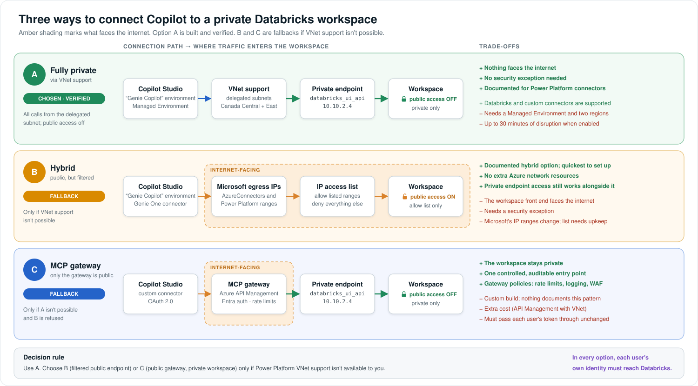

# 7. Design decisions: options considered and why

Every major choice in this solution had alternatives. This page records them so you can make the same choices
deliberately, or pick differently for your constraints.

---

## D1. Network path: VNet support vs public path vs gateway

| Option | What faces the internet | Pros | Cons | Choice |
|---|---|---|---|---|
| **A. Power Platform VNet support** | Nothing | Workspace stays private; no IP lists to maintain; the Databricks connector and custom connectors are supported | Needs a Managed Environment, two delegated subnets in the region pair, a change window to link | ✅ **Chosen and verified** |
| B. Public access + IP access list of Microsoft connector ranges | The workspace front end, filtered by IP | Simple | Needs a security exception; IP ranges change; anyone in those shared Microsoft ranges is "allowed" at the network layer | Fallback only |
| C. API gateway (for example Azure API Management in your VNet) | The gateway | Workspace stays private | Extra service to build, secure and pay for; the user's token must pass through | Fallback only |

## D2. Entry point: Genie One vs one tool per Genie space

Genie never has data access of its own: every query runs as the signed-in user, so Unity Catalog grants are the only
real security boundary. What differs between the two patterns is **how much of what the user can read becomes
reachable from Copilot**.

| User can read the table? | Table in a space the user can use? | Asked through | Result | Outcome |
|---|---|---|---|---|
| ✅ Yes | ✅ Yes | Space | Answers | As expected |
| ✅ Yes | ✅ Yes | Genie One | Answers, routed through the space and its business rules | As expected |
| ✅ Yes | ❌ No | Space | Refuses: data not in this space | Space scope narrows access |
| ✅ Yes | ❌ No | Genie One | Answers by querying the table directly | ⚠️ User permission wins |
| ❌ No | ✅ Yes (space shared with the user) | Space | Space disabled for that user (*no SELECT access* banner) | Permission always wins |
| ❌ No | ✅ Yes | Genie One | No data returned | Permission always wins |

A space can only **narrow** what a user reaches. It never widens it. Genie One isn't limited by spaces: if the user
can read a table, Genie One can answer from it.

| Aspect | **Pattern A: Copilot → Genie One** (one endpoint) | **Pattern B: Copilot → individual Genie spaces** (one tool per space) |
|---|---|---|
| Data reachable from Copilot | Everything the user can read in the workspace | Only tables inside the connected spaces, still subject to the user's grants |
| Data-leak risk | High if Unity Catalog grants are broad or poorly governed | Low: uncurated data is unreachable through Copilot, whatever the user's grants |
| Answer quality | Mixed: curated when routed through a space, uncurated when querying tables directly | Consistent: always curated tables, instructions and examples |
| Routing | Automatic: Genie One picks the space or data source | The Copilot Studio orchestrator picks the tool from each tool's name and description |
| Cross-domain questions | Handled automatically by combining sources | Need a purpose-made space that contains the tables for those domains |
| New Genie space | Available in Copilot immediately, with no change | Add a tool (or connection) for it in the agent, then republish |
| Copilot agents to maintain | One | Still one agent, with one tool per space |
| Governance dependency | Tight Unity Catalog grants only | Unity Catalog grants plus space curation (two layers) |
| Platform dependency | Genie One MCP server, **generally available** | Per-space endpoints: the per-space Genie MCP server (`/api/2.0/mcp/genie/{space_id}`, **Public Preview**, needs the Managed MCP Servers preview; also what the certified *Azure Databricks* connector's Genie tool calls) or the Genie Conversation API. Check each one's status and lifecycle before production ([guide 10](10-preview-features-and-production-readiness.md)). |

Pattern B was also tried with the certified Azure Databricks connector (action *Azure Databricks Genie*, operation
`InvokeGenieMCP`). With one tool per space it answered every test question, including the cross-domain one, in one
reply. Its Genie Space ID is fixed when you add the tool, each user's connection also asks for the workspace host,
warehouse path and workspace ID, and its poll tool sends identical calls, so a slow answer can hit the repeated-call
guard (D3).

**Recommendation**

| Area | Recommendation |
|---|---|
| Copilot integration | **Pattern B** by default: bind individual Genie spaces as tools in a single Copilot Studio agent |
| When Pattern A is acceptable | Only when Unity Catalog grants are reviewed and least-privilege, and **every table a user can read is acceptable to surface in Copilot** |
| Cross-domain needs | Build purpose-made spaces that combine the required tables, rather than relying on Genie One's routing |
| Stronger Databricks boundary (optional) | A curated business workspace (D11) |
| Genie One instructions | Keep them for terminology and clear "not available" messages; never rely on them for access control (D12) |

**Choice in the reference build: ✅ Pattern A (Genie One).** It's acceptable here because the grants are one schema per
domain and every table in each schema is in that domain's space, so nothing a test user can read is uncurated. It
also uses only GA Databricks endpoints. If your grants are broader, or a preview per-space endpoint is acceptable to
your architecture board, choose Pattern B.

### Operating process for Pattern B: when a new Genie space is published

| Step | Owner | Action |
|---|---|---|
| 1 | Data team | Create the space with curated tables, a clear business title and description, instructions and examples |
| 2 | Data team | Share it with the intended groups (**Can Run**); confirm their Unity Catalog grants cover every table in it |
| 3 | Data team | Raise a change request to expose the space in Copilot |
| 4 | Copilot team | Add a tool (or connection) for the space in the agent, with a name and description that match the space's purpose |
| 5 | Copilot team | Test with one user per access persona: allowed, partially allowed, not allowed |
| 6 | Copilot team | Republish the agent |
| 7 | Both | Record the space-to-tool mapping in the integration register |

## D3. How Copilot Studio calls Genie One

| Option | Result in testing | Choice |
|---|---|---|
| MCP server tool used with plain polling (`genie_ask`, then `genie_poll_response` until complete) | Works privately and per user. **But** `genie_poll_response` takes only `conversation_id` and `response_id`, so every poll is an **identical call**, and Copilot Studio stops a tool after three identical calls in one reply, whatever the model or instructions. Slow answers don't arrive in one reply. | Not used on its own |
| Agent flow (workflow tool) that loops until the answer is ready | Workflow tools allow 660 seconds, but per-user identity inside flows needs extra design | Not needed |
| **A. Two REST actions** on the custom connector (*Ask Genie One*, *Get Genie One result* with an `attempt` counter) | Each poll is unique (`?attempt=N`), so nothing is blocked. Answers arrive in **one reply** in Microsoft 365 Copilot and Teams. No preview dependency. About 36 Copilot Credits for a cross-domain question. | ✅ **Option A** |
| **B. MCP server** connector (created inside a solution) with Genie One's **interactive answer card** (*View ask*) | The agent makes **one** call; Genie's card polls inside the chat and shows the answer in Microsoft 365 Copilot. Teams, which doesn't display cards, receives a holding message and then the answer as text. No hand-written definition; new Genie One tools appear for review. About 6 Copilot Credits for the same question. MCP tools in this agent experience are **Preview**. | ✅ **Option B** |

Both A and B are documented and verified ([04 §4.1](04-genie-one-connector-and-copilot-agent.md#41-choose-the-connector-option)).
Choose **A** when no preview features are allowed or you need full control of the answer format. Choose **B** for
lower cost, less maintenance and Genie's richer answer, with the MCP preview recorded as an accepted exception.

Databricks accepts the Genie One MCP endpoint statelessly (a `tools/call` without an MCP session), ignores the extra
query parameter, and returns plain JSON. That is what makes option A possible. The repeated-call guard isn't listed
in the published runtime limits, so keep the `attempt` counter even if you change models.
[Agent runtime limits](https://learn.microsoft.com/en-us/microsoft-copilot-studio/agents-experience/runtime-limits) ·
[Use MCP apps in Copilot Studio](https://learn.microsoft.com/en-us/microsoft-copilot-studio/agents-experience/mcp-apps)

Genie One also offers `genie_get_query_result` (full rows of a query Genie One ran itself) and
`genie_cancel_response`. Neither is needed: the answer arrives in `final_answer` or the card, and the *Explore in
Databricks* link opens the full result.
## D4. Connector authentication: client secret vs managed identity (federated credential)

| Option | Pros | Cons | Choice |
|---|---|---|---|
| Client secret on the Entra app | Works everywhere, including the Copilot Studio MCP wizard (its manual OAuth option requires a secret). An MCP connector created in Power Apps instead can use managed identity. | A secret to store, rotate and protect; it expires and breaks sign-in on that date | Not used |
| Certificate | Stronger than a secret | Still expires and must be rotated; not offered for this flow | Not used |
| **Managed identity on the custom connector + federated credential on the app** | **No secret at all**; nothing expires; the trust is limited to that one connector | Needs a single-tenant app and a real tenant ID; a re-imported connector needs a new federated credential | ✅ **Chosen** |

A secret wouldn't have fixed any functional problem. It only changes how the connector proves its own identity
during token exchange. Users still sign in as themselves either way, and each user's one-time connection is needed
in both cases: it comes from the end-user credentials choice (D6), not from the credential type.
[Managed identity authentication for custom connectors](https://learn.microsoft.com/en-us/connectors/custom-connectors/azure-active-directory-authentication)

## D5. Token issuer: Microsoft Entra ID vs Databricks OAuth

| Option | Consideration | Choice |
|---|---|---|
| Databricks OAuth (app connection, workspace `/oidc` endpoints) | The OAuth **code exchange** is performed by Microsoft's shared consent service, which isn't inside your VNet. With public access disabled, it can't reach the workspace's token endpoint. | Not used |
| **Microsoft Entra ID** (`login.microsoftonline.com`, resource AzureDatabricks) | Always reachable; Azure Databricks accepts Entra user tokens on the Genie One endpoint (verified with `initialize` and `tools/list`) | ✅ **Chosen** |

## D6. Credentials used by the tools: end user vs maker

| Option | Effect | Choice |
|---|---|---|
| Maker-provided credentials | Every user would query with the maker's permissions | Never for data tools |
| **End user account** | Each user signs in once; Unity Catalog applies their own grants | ✅ **Chosen** |
| Agent-level single sign-on with token pass-through (agent authenticates the user with Microsoft Entra ID, requests the Azure Databricks scope, and passes `System.User.AccessToken` to a connector without its own authentication) | Removes the per-user connection step in channels that support single sign-on, while keeping per-user identity. More components, and the token must never be exposed to the model or logs. | Not built here. Prove it in a pilot with a security review if a zero-click experience is mandatory. |

The one-time connection is needed for **every** connector or MCP tool that signs in per user, including the certified
Azure Databricks connector. Each user needs one connection per connector per environment, not one per agent. With
admin consent granted it is a single click with single sign-on, and it lasts until the token is revoked or expires
from inactivity. Automate the onboarding, for example a flow that sends the agent's sharing link when someone joins the users'
group. A user's own sign-in can't be created on their behalf.

## D7. Model

| Option | Consideration | Choice |
|---|---|---|
| Auto | The model can change per message; behaviour is less predictable | Not used |
| **Claude Sonnet** (Databricks' recommendation for Genie in Copilot Studio) | Consistent tool use and polling | ✅ Chosen (Claude Sonnet 5.5) |
| A specific GPT model | Use if Anthropic models aren't allowed in your tenant | Valid alternative |

## D8. Subnet size and environment type

| Option | Choice and reason |
|---|---|
| /27 vs **/26** delegated subnets | **/26**: Microsoft advises 25–30 IPs per production environment. The range can't change without unlinking. |
| Sandbox vs **Production** environment | **Production**: the agent serves real users. VNet support works with both, but not with Trial. |

## D9. Sharing the custom connector: individuals vs group team

| Option | Choice and reason |
|---|---|
| Share with each user | Works, but doesn't scale and drifts from the group |
| **Dataverse group team for the Entra group** | ✅ Membership follows the Entra group automatically; one place to manage access |

## D10. Environments: one environment vs Dev, Test and Prod

| Option | Choice and reason |
|---|---|
| One Production environment, edited directly | Acceptable for a proof of concept, which is how the reference build was made |
| **Dev → Test → Prod**, with the agent and connector in a **solution** | ✅ Recommended for production. Makers edit an unmanaged solution in Dev; Test and Prod receive a **managed** (read-only) solution through Power Platform Pipelines or Azure DevOps or GitHub. |

What travels in the solution: the agent, the custom connector, **connection references** and **environment
variables** (for example the workspace host per environment). What must be set up in each environment: the VNet
support link, the data policy scope and URL rules, the security group, the Dataverse group team and connector
sharing, the pay-as-you-go link, channel publishing (Prod only) and each user's own connection.

Each imported connector gets a **new managed identity**, so it needs its own redirect URI and federated credential.
Use one app registration per environment (for example `copilot-genie-one-mcp-dev` and `-prod`) to keep identities and
assignments separate.

## D11. Limiting what Genie One can reach

| Option | Effect | Choice |
|---|---|---|
| Workspace-level Genie One instructions (*"answer only through agents"*) | **Not enforced.** One run answered from the table directly; a repeat run refused. Not deterministic. | Not access control (D12) |
| Genie One admin settings | No setting limits Genie One chat to spaces only | Not available |
| Restrict `EXECUTE` on `system.ai.genie_one_mcp` | Controls **who** can call Genie One, not **what** it reads | Optional, for least privilege on the entry point |
| **Least-privilege Unity Catalog grants** | Genie One can reach only what the user can read | ✅ Required with Pattern A |
| Business-facing workspace with **catalog-workspace binding** to curated catalogs only | Genie One in that workspace can't reach raw data. Users keep their grants in the engineering workspaces. | Optional, stronger. Not built here. |
| Connect Copilot to individual spaces (D2, Pattern B) | Copilot can't reach uncurated data at all | ✅ Recommended when grants are broad |

## D12. Instructions vs access control

| Use instructions for | Don't use them for |
|---|---|
| Terminology, units, business rules, formatting, and clear *"This data isn't available with your current access"* messages | Deciding which data a user may reach. Only Unity Catalog grants (and, for an agent, its configured tables) do that. |

Keep instructions free of sensitive details: anyone who can use a space can read them, and Genie may quote them in
answers.
