# Diagrams

Every diagram is a vector **SVG** in [`images/`](images/), so it stays sharp at any zoom. A **3× resolution PNG** of
each, for slides and documents, is in [`images/png/`](images/png/). All names, URLs and IP addresses are example values.

| # | Diagram | Read it when you want to… |
|---|---|---|
| 1 | [As-built architecture](#1-as-built-architecture) | see the whole solution on one page |
| 2 | [Private workspace network](#2-private-workspace-network) | understand the Databricks network side |
| 3 | [Permission model](#3-permission-model) | see who can read what |
| 4 | [Genie One request sequence (Databricks view)](#4-genie-one-request-sequence-databricks-view) | understand ask-and-poll in Databricks |
| 5 | [Network options](#5-network-options) | compare the private path with the fallbacks |
| 6 | [Designing domain agents](#6-designing-domain-agents) | design Genie spaces that share attributes safely |
| 7 | [Build phases and outcome](#7-build-phases-and-outcome) | see what was built, in order, and the result |
| 8 | [Fully private path with VNet support](#8-fully-private-path-with-power-platform-vnet-support) | build the delegated subnets and enterprise policy |
| 9 | [How one question is answered](#9-how-one-question-is-answered) | follow one Copilot question end to end (option A) |
| 10 | [Identity without secrets](#10-identity-without-secrets) | understand sign-in, the managed identity and the federated credential |
| 11 | [Governance and security controls](#11-governance-and-security-controls) | review every control by layer |
| 12 | [How it's billed](#12-how-its-billed) | understand where each cost lands |
| 13 | [Connector options](#13-connector-options) | compare option A (two REST actions) with option B (MCP server) |

---

## 1. As-built architecture
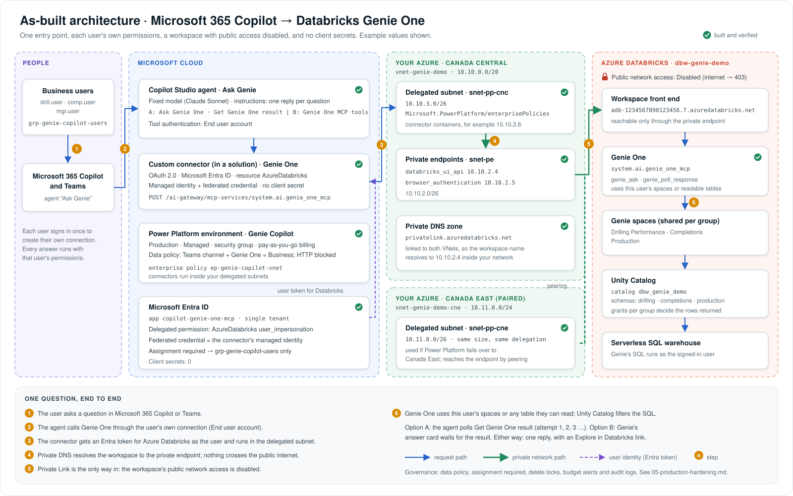

Read it left to right: **people → Microsoft cloud → your Azure network → Databricks**. The numbered steps follow one
question. The **purple dashed line** is the user's Entra token, which is why Unity Catalog applies each user's own
grants. The **green path** is the only way into the workspace: delegated subnet → private endpoint. Public network
access is disabled. [PNG](images/png/01-target-architecture.png)

## 2. Private workspace network
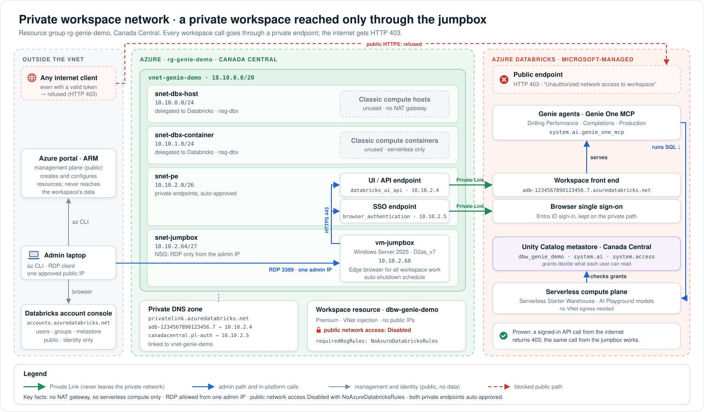

The workspace VNet has subnets for Databricks compute (unused, since Genie runs on serverless), private endpoints and
an admin jumpbox. The private DNS zone resolves the workspace name to the private endpoint inside the VNet. Internet
requests get HTTP 403. [PNG](images/png/02-lab-network.png)

## 3. Permission model
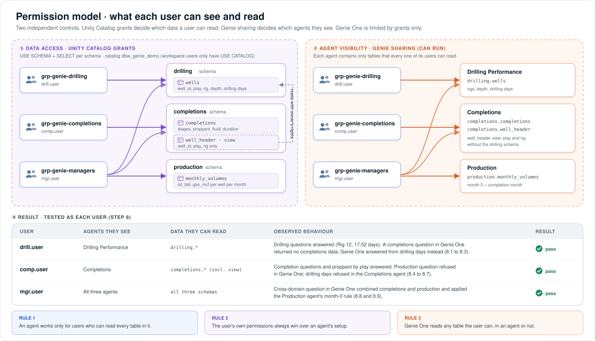

Two independent controls: **Unity Catalog grants** decide which data a group can read, and **Genie space sharing**
decides which spaces a group can see. Only the grants limit Genie One: it can also query any readable table that's in
no space. The `well_header` view gives completions users play and rig without access to the drilling schema. [PNG](images/png/03-permission-model.png)

## 4. Genie One request sequence (Databricks view)
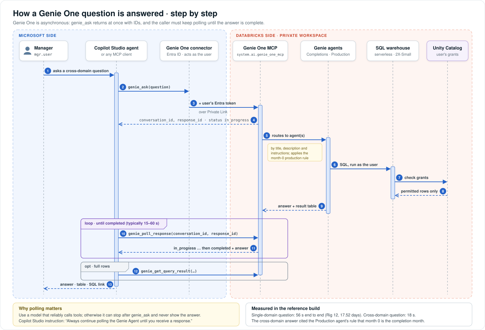

`genie_ask` returns at once with IDs. Genie One routes to the right spaces (or queries readable tables directly) and runs SQL as the user, and the caller polls
`genie_poll_response` until the answer is complete. Diagram 9 shows how Copilot Studio does this.
[PNG](images/png/04-genie-one-sequence.png)

## 5. Network options
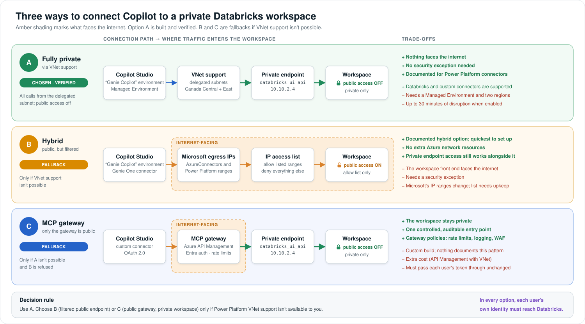

**A, Power Platform VNet support** (chosen and verified) exposes nothing to the internet. **B** (IP-filtered public
endpoint) and **C** (API gateway) are fallbacks. See [07-design-decisions.md](07-design-decisions.md).
[PNG](images/png/05-network-options.png)

## 6. Designing domain agents
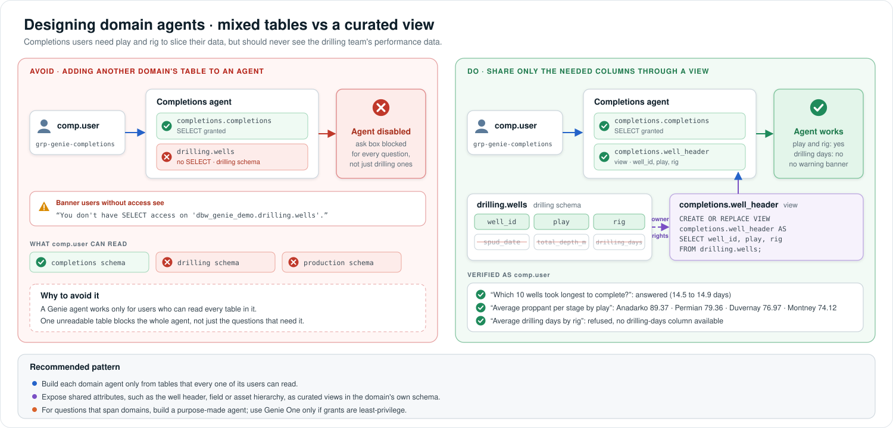

Don't add another domain's table to a Genie space, because users without access to it lose the whole space. Expose
only the needed columns through a curated view. For cross-domain questions, build a purpose-made space, or use Genie
One only when grants are least-privilege ([07 D2](07-design-decisions.md#d2-entry-point-genie-one-vs-one-tool-per-genie-space)).
[PNG](images/png/06-agent-design-pattern.png)

## 7. Build phases and outcome
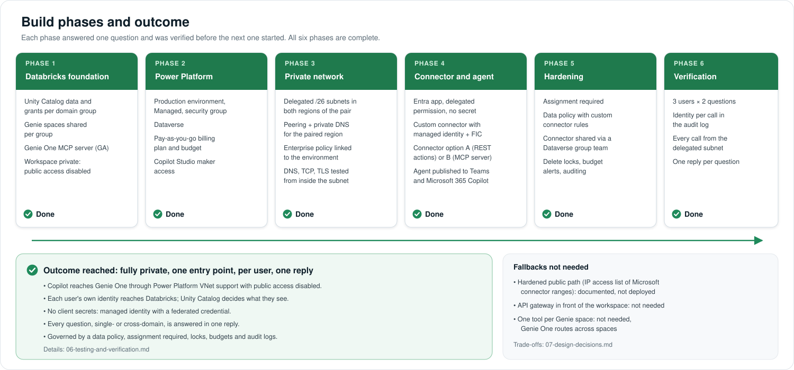

Six phases, each verified before the next. The outcome reached is **fully private, one entry point, per user, one
reply**. The fallbacks weren't needed. [PNG](images/png/07-roadmap-and-outcomes.png)

## 8. Fully private path with Power Platform VNet support
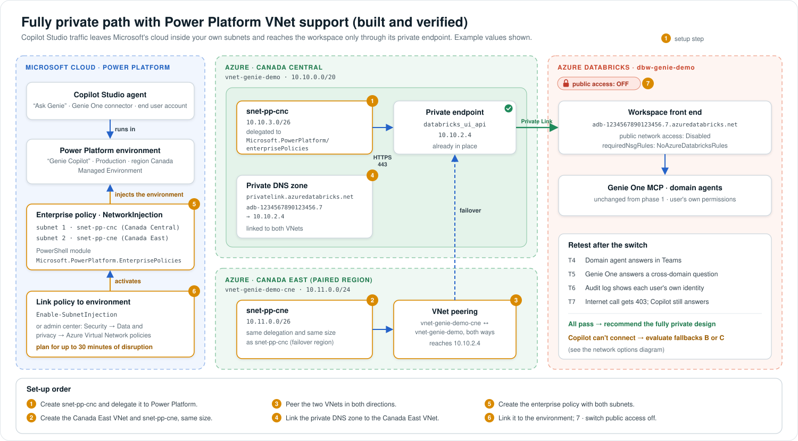

The environment is linked to an enterprise policy with two delegated `/26` subnets, one per region of the pair. The
primary subnet reaches the private endpoint directly; the paired region reaches it through peering. The private DNS
zone is linked to both VNets. The numbered badges give the set-up order. Full steps:
[03-private-connectivity-power-platform-vnet.md](03-private-connectivity-power-platform-vnet.md).
[PNG](images/png/08-private-path-vnet-support.png)

## 9. How one question is answered
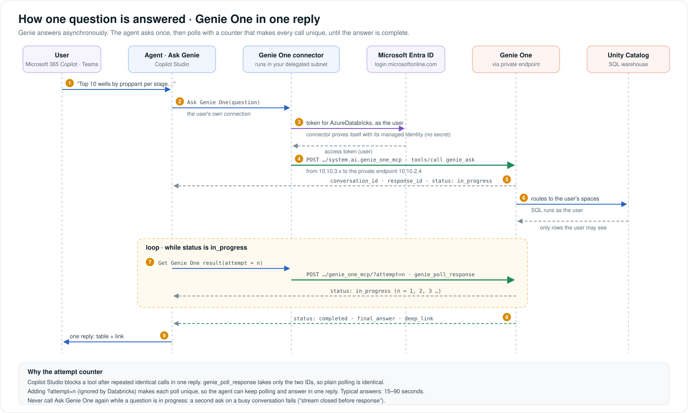

This shows connector **option A**; option B is in diagram 13. The agent calls **Ask Genie One** once. The
connector gets a token for the user and calls Genie One privately. The agent then calls **Get Genie One result** with `attempt = 1, 2, 3 …` until the status is `completed`. The counter makes
every poll unique, so Copilot Studio never blocks it, and the user gets the answer in one reply.
[PNG](images/png/09-request-sequence.png)

## 10. Identity without secrets
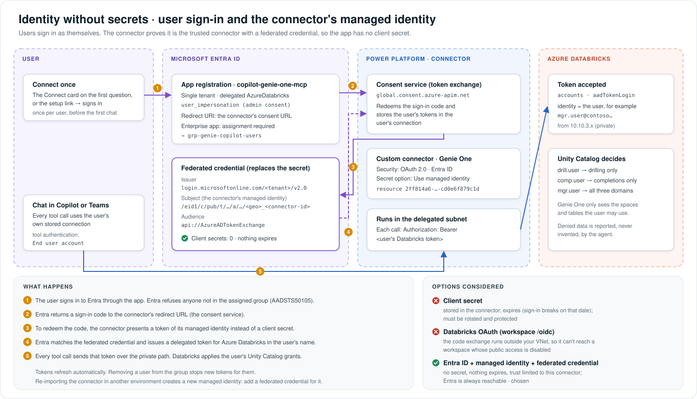

Users sign in through the Entra app, and only the assigned group is allowed. The connector redeems the sign-in using
a token of its **managed identity**, which the app trusts through a **federated credential**, so no client secret
exists. The options considered (client secret, Databricks OAuth) are compared on the right.
[PNG](images/png/10-identity-secretless-auth.png)

## 11. Governance and security controls
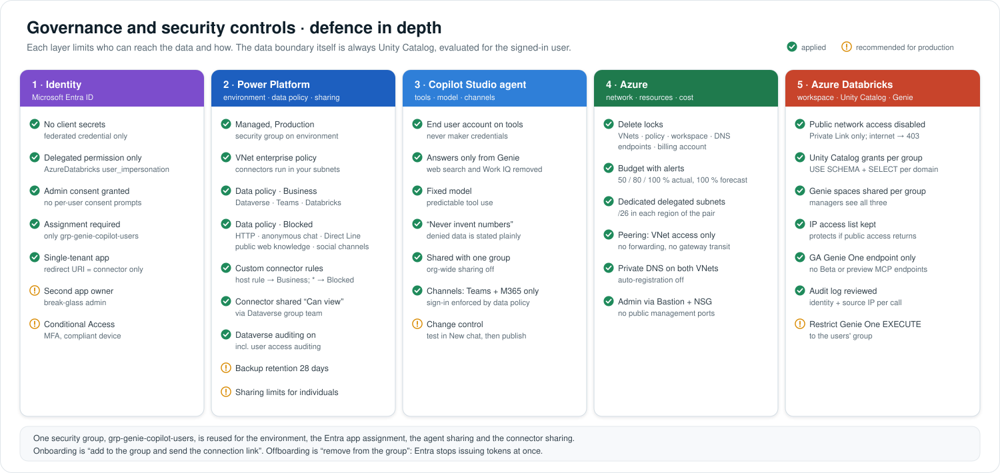

Controls across five layers: identity, Power Platform, Copilot Studio, Azure and Databricks. Green ticks are applied
in the reference build; amber marks are recommended for production. Details:
[05-production-hardening.md](05-production-hardening.md). [PNG](images/png/11-governance-controls.png)

## 12. How it's billed
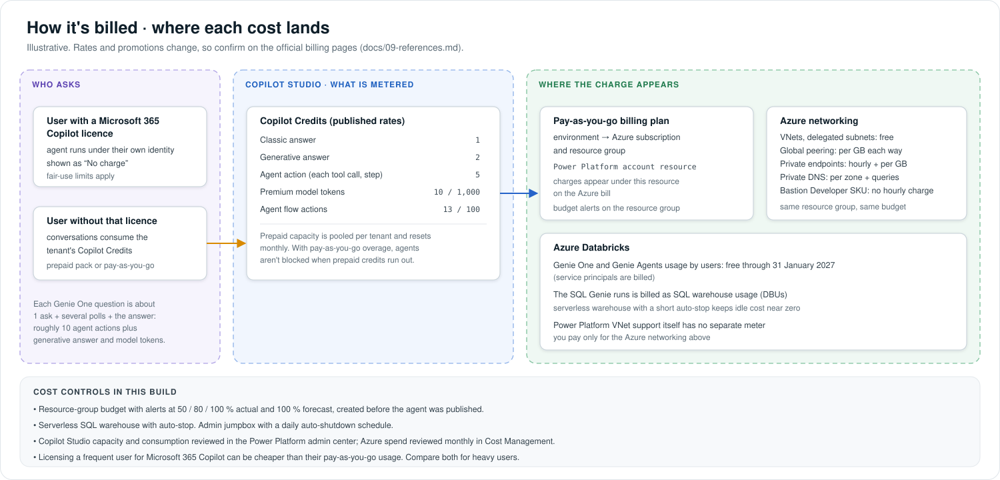

Copilot Studio usage is metered in **Copilot Credits** and lands on the pay-as-you-go billing plan's Power Platform
account resource. Licensed Microsoft 365 Copilot users running under their own identity are shown as "No charge".
Networking lands in the same resource group, and Databricks bills the SQL warehouse. Details:
[02-prerequisites-licensing-and-billing.md](02-prerequisites-licensing-and-billing.md).
[PNG](images/png/12-billing-flow.png)

## 13. Connector options
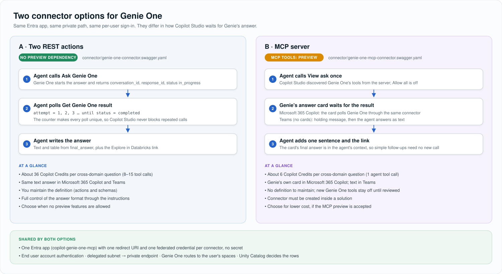

**Option A** defines two REST actions: the agent asks once and polls with a counter until the answer is complete.
**Option B** connects Genie One as an MCP server: the agent calls *View ask* once, and Genie's answer card waits for
the result in Microsoft 365 Copilot (Teams receives text). Both share the Entra app, the private path and per-user
sign-in. Details: [04 §4.1](04-genie-one-connector-and-copilot-agent.md#41-choose-the-connector-option).
[PNG](images/png/13-connector-options.png)
